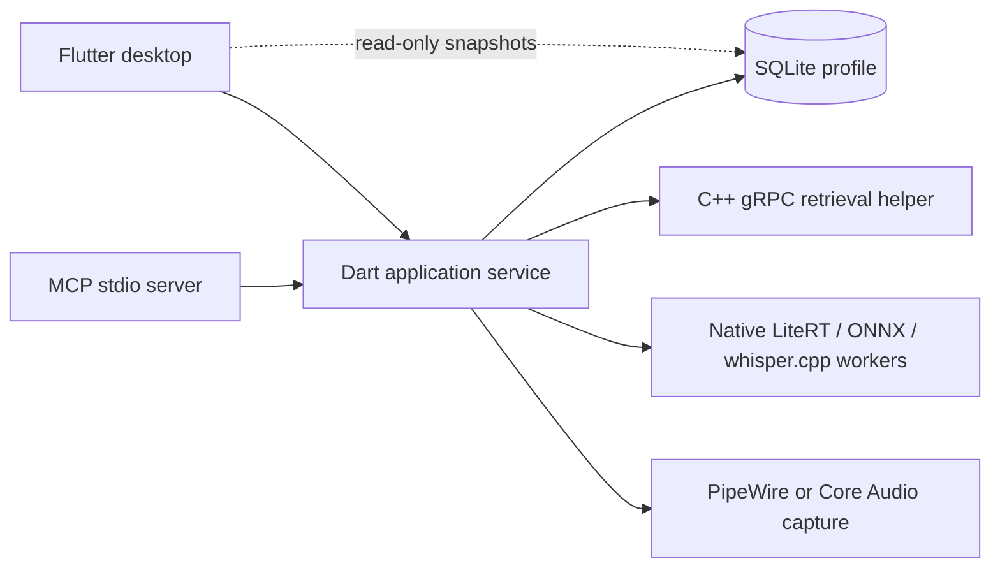

<p align="center">
  
</p>

<h1 align="center">Open Foresight</h1>

<p align="center">
  Offline AI meeting notes, transcription, and a cited knowledge base for Linux and macOS.<br>
  An open-source alternative to Google AI Edge Foresight and Granola. Record and transcribe meetings, import your sources, and ask questions with checked citations, all with models that run on your own machine.
</p>

---

## What is Open Foresight?

Open Foresight is a meeting companion and personal knowledge base that runs entirely on your own computer. It is an open-source, cross-platform reconstruction of Google's **AI Edge Foresight**, an experimental offline meeting-notes app for the Mac that Google announced in October 2026.

**In meetings**, it transcribes your microphone and system audio, so it works with any meeting app and with in-person conversations. You jot down short notes as you go, and Open Foresight expands them into fuller notes using the live transcript. A side panel lets you ask questions about the meeting as it happens, and produces a summary and a list of action items afterwards.

**Between meetings**, it is a searchable library of your own documents: local files, web pages, and Google Drive content. Ask it a question and it answers from those sources, with citations checked against them, so you can find a detail without rereading everything.

**Everything stays local.** Gemma models write the answers and notes, EmbeddingGemma powers source search, and Whisper transcribes speech, all on your machine. Your audio, transcripts, notes, and documents are kept in a local profile, and no prompt is ever sent to a cloud model. The network is only needed to download models, fetch web pages you import, and sync Google Drive and Calendar if you connect them.

Google's app runs only on the Mac. Open Foresight runs on Linux and on Apple Silicon Macs, adds an MCP server so AI agents can use the same library and recorder, and is MIT-licensed.

## How this project started

Open Foresight began as an experiment: **how far can an AI agent equipped with [REA](https://github.com/morluto/rea) (Reverse Engineer Anything) go in replicating a shipped Mac application, and porting it to Linux?**

The reference was Google's macOS **AI Edge Foresight** app (`com.google.AIEdgeForesight`), a Flutter app with local Gemma models, source search, a source graph, and meeting transcription. The experiment used two hosts:

- **Linux with REA**: static analysis of a copied `.app` bundle. This covered its plists, resources, protobuf schemas and model configuration, plus the arm64 Mach-O decompiled through REA's IDA provider. In the Flutter AOT code, recovered strings and pseudocode exposed contracts even though the original Dart source could not be recovered.
- **A Mac through [herdr](docs/rea-linux-and-herdr-mac.md#mac-terminal-control-through-herdr)**: the installed app was run and observed directly, to establish what it actually does at runtime. Static analysis alone cannot show that.

The work went one feature at a time. Each round identified the feature's contract and inspected the relevant code, observed the same workflow on the Mac, built it here, and compared the two with identical inputs. Parity meant matching state changes, persistence, errors and cancellation, not just matching screenshots. Where the original depended on Mac-only pieces, the port used open replacements: PipeWire instead of Core Audio, public LiteRT model artifacts instead of encrypted model packages, and Linux window and shortcut integration in place of the Mac's.

The full method, including its limits and how evidence was kept, is in [Replicating Foresight with REA on Linux and herdr on Mac](docs/rea-linux-and-herdr-mac.md).

## From port to cross-platform app

Once the Linux reconstruction worked, the project stopped being only a copy and became an application of its own:

1. **Reconstruct.** A Flutter interface, a C++ gRPC retrieval helper, SQLite persistence, and native model and capture workers rebuilt the reference's main workflows on Linux.
2. **Own the stack.** Python inference was replaced with native C++ LiteRT and ONNX workers. Business logic moved into a Flutter-independent application service, which both the desktop and a new MCP server share. Linux gained `.deb`, `.rpm` and Arch packages.
3. **Return to the Mac.** With the platform-specific parts behind small interfaces, macOS became a target again. Apple Silicon support now includes native Core Audio capture, a Mac runner, bundle tooling, and a release DMG, all from the same codebase.

The repository has a fresh history. Reference screenshots, reverse-engineering reports, evaluation results, machine-specific environments, downloaded models, application profiles and credentials are all excluded. Runtime fonts and images are kept because the interface uses them.

## Features

- **Sources.** Import files and folders (text, Markdown, PDF, RTF), web pages by URL, and Google Drive content: single files, a whole folder, or the last year of files. Google Docs, Sheets and Slides are converted to text. A file finder helps you locate documents on your computer to add. Everything is indexed locally, and you can pause and resume importing and indexing.
- **Organize.** Search, sort, and filter sources by type, in a list or a grid, and tag them with labels.
- **Source graph.** Explore your sources as a force-directed graph of semantic links, with clusters and labels. Selecting a document shows related ones. The layout persists between sessions.
- **Ask.** Get grounded answers from a local Gemma model, with citations checked against your sources. If verification fails, the answer is replaced by a fallback that is clearly labelled as one.
- **Meetings.** See upcoming Google Calendar meetings and get reminders for them. Transcription captures the microphone and system audio. The meeting workspace has:
  - Markdown notes, which can be enhanced live in a Standard or Concise style
  - a sidecar with meeting-scoped Chat, Live Q&A, Summary, Transcript, and Action items

  Live Q&A can detect questions in finalized speech and queue grounded answers automatically using the local model. Its Automatic answers switch pauses processing while retaining queued questions; failed answers can be retried.

  Recording can be paused and resumed, and stops itself after a period of inactivity that you choose. Double-click its waveform or use Full screen to open the immersive meeting workspace. Generated notes, summaries, action items and answers render as formatted, selectable Markdown, with original Markdown retained for editing and copying. You can export your meeting notes as Markdown. Original notes and raw transcripts are never overwritten by generated text.
- **Notes.** Write personal notes, and start a new one with Ctrl+N (⌘N on the Mac).
- **Stats.** A dashboard of sources added, meetings transcribed, answers given, and weekly local output tokens.
- **MCP server.** Agents can import, search, ask, take notes, and record through the same application service the desktop uses.
- **Desktop integration.** A global shortcut to quick-start a meeting, desktop notifications, a monitor for the local helper, and a background service that keeps recording after the window closes.

## Beyond the original

Open Foresight reproduces the original's main workflows, and adds features the original does not have:

- **Linux support.** Native packages for Ubuntu, Debian, Fedora, and Arch/Omarchy, with PipeWire audio capture and Linux global shortcuts, including on Hyprland. The same codebase also builds for the Mac.
- **An MCP server for agents.** The original has no MCP interface. MCP clients can search, import, ask, write notes, and record through the same service the desktop uses. The service runs headless, without a window.
- **More model choices.** The original's settings offer a choice of Gemma model only. Open Foresight also lets you choose:
  - the source search model
  - the transcription model: multilingual Whisper from Tiny to Large v3 Turbo, which keeps Chinese and English speech in the language it was spoken

  You can also register model files you already have, and run Whisper on the GPU through Vulkan.
- **Audio routing.** Choose which microphone and which system playback output to transcribe, and see live input levels.
- **Auto-stop can be turned off.** Along with 5, 10, 15, and 30 minutes, inactivity auto-stop can be set to Never.
- **Bring your own Google project.** Drive and Calendar can use an OAuth client configuration that you import.
- **Local and open.** Models are public LiteRT and whisper.cpp files, pinned by SHA-256 hash, and generation never calls a cloud model. The source code is MIT-licensed.
- **Isolated profiles.** You can run separate profiles side by side, and migrate an existing profile with a tool that keeps a verified backup.

### Original-app parity

Web-search fallback and the original remote Gemini summary RPC are implemented
for optional web-enabled Ask and meeting Chat. Distribution credentials and live
service verification remain pending; no separate user project setup is required.
Ordinary answer generation remains local.

The original's single-note Markdown export format has now been observed live and reproduced, with date filters, preview, copy and download. Additional export scenarios and label editing still need reference verification; see the [feature parity progress ledger](docs/feature-parity-progress.md).

Pause/resume and an immersive workspace are implemented. Exact original gestures and physical-audio behavior remain under [investigation and validation](docs/missing-functions-investigation.md).

Automatic meeting answers now use a reconstructed dedicated detector when its authenticated asset is registered. Nine controlled parsed outputs match the original GPU runtime. Model setup now includes authenticated acquisition and encrypted storage when the distribution supplies its shared credential; live service/release validation and broader numerical comparison remain pending. Search configuration is also [under investigation](docs/ida-search-investigation.md); a separate user project has not been established as a requirement.

Transcripts label microphone and remote audio channels as Microphone and Remote, with Unknown for other sources. These are capture routes, not individual-speaker identification. Meeting generation is instructed to attribute statements only to clearly established real names.

On macOS, Settings offers optional echo cancellation using system voice processing. The setting defaults to off, reports active processing or standard-recording fallback, and can bypass processing during a recording. Enabling it on a standard recording requires restarting that recording. Physical echo-cancellation quality and comparison with the original remain unverified; see the [implementation ledger](docs/missing-functions-investigation.md).

## Platform status

| Platform | Status | Distribution |
| --- | --- | --- |
| **Linux** x86-64: Ubuntu 24.04, Debian 13, Fedora 44, Arch/Omarchy | Established target | `.deb`, `.rpm`, and Arch packages on [GitHub releases](https://github.com/teng-lin/open-foresight/releases) |
| **macOS 15+** on Apple Silicon | In integration. Native capture, the Mac runner, and bundle tooling are implemented. Developer ID signing, notarization, and physical-device validation are still required. | Ad-hoc-signed DMG on GitHub releases |

The macOS state is tracked in the [validation ledger](docs/macos-validation.md) and the [support plan's remaining gates](docs/macos-support-plan.md).

## Install

Download a package for your distribution, or the macOS DMG, from the [releases page](https://github.com/teng-lin/open-foresight/releases). Each installer is built and tested in CI when a release is published. See [Linux packaging](docs/linux-packaging.md) and [macOS release CI](docs/macos-support.md#release-ci-disk-image) for details.

The current DMG is ad-hoc signed and not notarized, so macOS warns you the first time you open it.

### First launch

On first launch, setup offers three Gemma 4 generation models: **12B**, **E4B**, and **E2B**, which need about 30, 15, and 6 GB of memory respectively. It downloads the selected model and the **EmbeddingGemma 2** source-search model, checks their pinned sizes and SHA-256 hashes, and registers each model only after it loads successfully. You can cancel safely, and completed downloads are kept if setup is interrupted. Meeting transcription offers multilingual Whisper models from Tiny to Large v3 Turbo, under **Settings → Transcription Model**.

Having enough system RAM does not guarantee that a model fits on your GPU. See [speech model behavior](docs/speech-models.md) and [native inference](services/inference/README.md) for details.

## Architecture



There is one application service per profile. It owns every database write, the loaded models, imports, Google sync, and the recording session. The desktop and MCP clients attach to the service over a private Unix socket, and closing either one does not stop a recording or unload a model. See [Application service and MCP](docs/application-service.md).

| Path | Contents |
| --- | --- |
| `apps/desktop` | Flutter interface, with Linux and macOS runners |
| `packages/foresight_core` | Application operations, service and MCP entry points, persistence, sources, meetings, cited answers |
| `services/helper` | gRPC retrieval helper |
| `services/inference` | Native LiteRT/ONNX worker and the Mac runtime adapter |
| `native` | Generation, speech, and audio capture adapters |
| `proto` | Service definitions and the protocol descriptor |
| `packaging` | Linux package builders, SDK/build containers, ABI checks |
| `tests` | Contract, lifecycle, service, and grounding tests with controlled fixtures |
| `tools` | Build, packaging, model setup, migration, and opt-in integration tests |

## Build from source

These commands target Linux. For macOS, see [Mac build, bundle, and MCP instructions](docs/macos-support.md); it uses a source-built dependency SDK and `tools/package_macos.py`.

**Requirements:**

- a C++20 compiler and CMake
- protobuf and gRPC development packages
- SQLite3, nlohmann-json, OpenSSL, and ICU
- Python, for build and test tooling
- Flutter, with the GTK3 Linux development dependencies

Flutter package dependencies are pinned in the source. The reference toolchain is Flutter 3.35.7, protobuf 36.1, gRPC 1.83.1, and nlohmann-json 3.12.

```sh
uv venv .venv
uv pip install --python .venv/bin/python -r requirements-dev.txt
python3 tools/prepare_litert.py build/lib/liblitert-lm.so
python3 tools/prepare_onnx.py build/lib/libonnxruntime.so
./tools/build.sh
python3 tools/package.py
./tools/run_desktop.sh
```

The bundle is written to `dist/open-foresight/` and contains three programs:

- `open-foresight`: the desktop app
- `open-foresight-mcp`: the MCP stdio server
- `open-foresight-service`: the foreground service and administration commands

The distributed app runs native C++ inference and does not need Python.

### Packaging options

```sh
# Package Gemma GPU generation into a separate, unused output directory
python3 tools/package.py --output dist/open-foresight-gemma --generation-backend gpu
# Optional native compatibility embedding model and CPU generation/speech runtimes
python3 tools/download_embedding_fixture.py models/local/all-MiniLM-L6-v2 --native
python3 native/setup_models.py --directory models/local/native
```

For Whisper GPU packaging, use `--whisper-gpu-runtime` and `--whisper-gpu-device`, and check device indices on the target machine. PDF and RTF import uses `pdftotext` and `unrtf`. Recording needs PipeWire and `pw-record`.

To build reproducible distro packages inside containers, see [Linux packaging](docs/linux-packaging.md).

## Profiles and data

The profile is stored in `$XDG_DATA_HOME/open-foresight`, which is normally `~/.local/share/open-foresight`. Sockets are in `$XDG_RUNTIME_DIR/open-foresight`. Set both `FORESIGHT_DATA` and `FORESIGHT_RUNTIME` to use an isolated profile. Legacy profiles are never selected automatically.

To migrate a profile from the earlier `foresight-linux-desktop` build, stop its app and helper, then run:

```sh
python3 tools/migrate_profile.py ~/.local/share/foresight-linux-desktop \
  ~/.local/share/open-foresight --backup ~/.local/state/open-foresight/profile-backup \
  --old-bundle /path/to/old/dist/foresight \
  --new-bundle "$PWD/dist/open-foresight" --copy-external-models
```

Migration refuses to run while the old profile has an active owner, an unfinished recording, or an existing destination. It keeps a private backup, checks SQLite integrity, and updates the model and file paths it owns. Backups contain private data, so keep them out of Git.

## Use it from an MCP client

```json
{
  "mcpServers": {
    "open-foresight": {
      "command": "/absolute/path/to/dist/open-foresight/open-foresight-mcp"
    }
  }
}
```

On macOS, the command is `/Applications/Open Foresight.app/Contents/MacOS/foresight-mcp`. The MCP server attaches to the same service as the desktop, or starts that service if it isn't running. Connecting does not download models or request capture permissions. See [Application service and MCP](docs/application-service.md#tools) for the tool list.

## Google connections

Drive and Calendar use browser authorization with your own OAuth client. Provide it at packaging time with `tools/package.py --google-client /path/to/google-client.json`, or in the app's configuration setting. Packaging does not inspect other applications or copy account tokens. Keep OAuth configuration and tokens out of Git.

## Verification

```sh
python3 tools/verify_descriptor.py
python3 -m pytest tests/contracts tests/models/test_grounded_generation.py
cmake --build build --parallel
ctest --test-dir build --output-on-failure
cd apps/desktop
flutter test
flutter analyze
```

Tests that use real models, real capture, or the desktop integration are opt-in. They need their tools and models installed. Their reports and captures go under the ignored `test-results/` directory, or a path you choose.

## Versioning and releases

The version is written in one place, `apps/desktop/pubspec.yaml`, as `version: X.Y.Z+N`. `X.Y.Z` is the release version, following [SemVer](https://semver.org). `N` is a build number that must increase with every release, because macOS compares it between installs. CMake, the helper's build ID, the packaging scripts, the MCP server, and the app all read this value. The app shows it under **Settings → Version**.

To cut a release:

```sh
python3 tools/app_version.py --set 0.2.0   # updates the pubspec and its derived copies, bumps the build number
git commit -am "chore: release v0.2.0"
git tag v0.2.0 && git push origin main v0.2.0
gh release create v0.2.0 --generate-notes  # builds the Linux packages and the macOS DMG
```

`python3 tools/app_version.py` prints the current version, and `--check` fails if a derived copy is out of date. Release CI refuses a tag that does not match `v` plus the pubspec version.

## Documentation

| Topic | Document |
| --- | --- |
| Reverse-engineering workflow | [Replicating Foresight with REA on Linux and herdr on Mac](docs/rea-linux-and-herdr-mac.md) |
| Desktop UI parity with the original | [ui-parity-validation.md](docs/ui-parity-validation.md) |
| Application service and MCP | [application-service.md](docs/application-service.md) · [design plan](docs/application-service-plan.md) |
| Native inference | [services/inference](services/inference/README.md) · [validation](docs/native-inference-validation.md) |
| Speech models | [speech-models.md](docs/speech-models.md) |
| Linux packages and CI | [linux-packaging.md](docs/linux-packaging.md) |
| macOS | [build and release](docs/macos-support.md) · [support plan](docs/macos-support-plan.md) · [validation ledger](docs/macos-validation.md) · [audio feasibility](docs/macos-audio-feasibility.md) |

## License

Open Foresight is released under the [MIT License](LICENSE). Third-party components keep their own licenses, which are included under `third_party/` and in packaged builds.

## Disclaimer

Open Foresight is an independent project. It is not affiliated with, endorsed by, or supported by Google. "Foresight" refers to the reference application this project studied.
