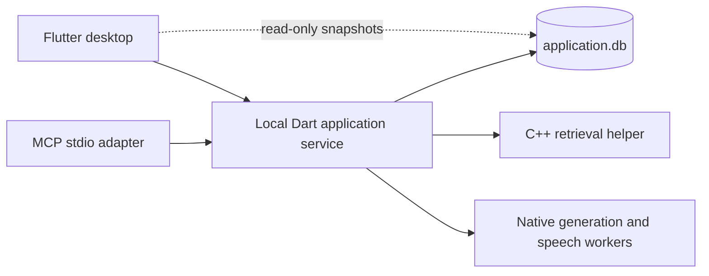

# Application service and MCP

Open Foresight uses one application service per profile. The Flutter desktop and MCP adapter share that service, its database writer, local models, retrieval helper, and recording session. The desktop opens a read-only SQLite WAL connection for rendering queries. All mutations go through named application operations on a private Unix socket.



The Flutter-independent package is `packages/foresight_core`. Desktop files such as `domain.dart` and `store.dart` remain compatibility exports for existing callers. Application operations, imports, source recovery, Google sync, model configuration, capture persistence, inactivity shutdown, and note enhancement live in the core. The desktop retains dialogs, browser interaction entrypoints, shortcuts, presentation, and graph layout/rendering; graph publications are validated and committed by the service.

## Build

Use the root build requirements and commands. Dart must be on PATH (the Flutter SDK supplies it). `tools/build.sh` builds the native components, checks/tests the core, compiles the service and MCP executables, and checks/tests/builds Flutter. `tools/package.py` includes all three entrypoints and their runtime libraries:

- `dist/open-foresight/open-foresight`: desktop.
- `dist/open-foresight/open-foresight-mcp`: MCP stdio server.
- `dist/open-foresight/open-foresight-service`: foreground service and administration commands.

For just the Dart executables after native compilation:

```sh
cd packages/foresight_core
dart pub get
dart analyze
dart test
cd ../..
mkdir -p build/application
dart compile exe packages/foresight_core/bin/service.dart -o build/application/foresight-service
dart compile exe packages/foresight_core/bin/mcp.dart -o build/application/foresight-mcp
```

A packaged service or MCP adapter requires no Flutter SDK, Dart SDK, or open desktop window. The existing native runtime and model prerequisites still apply. No model downloads occur merely because an MCP client connects.

## Configure an MCP client

Use the packaged stdio launcher:

```json
{
  "mcpServers": {
    "open-foresight": {
      "command": "/absolute/path/to/dist/open-foresight/open-foresight-mcp"
    }
  }
}
```

The default profile is `$XDG_DATA_HOME/open-foresight`, normally `~/.local/share/open-foresight`. Desktop and MCP must resolve the same profile and runtime directory. To choose an isolated profile, set both `FORESIGHT_DATA` and `FORESIGHT_RUNTIME` in the launcher environment:

```json
{
  "mcpServers": {
    "open-foresight": {
      "command": "/absolute/path/to/dist/open-foresight/open-foresight-mcp",
      "env": {
        "FORESIGHT_DATA": "/absolute/private/profile",
        "FORESIGHT_RUNTIME": "/absolute/private/runtime"
      }
    }
  }
}
```

Both directories must be owned by the current user and inaccessible to other users. The launcher creates missing directories with mode 0700, and the service socket uses mode 0600. It opens no TCP listener. The adapter uses the pinned `mcp_dart` SDK for protocol negotiation, validation, stdio framing, progress, and cancellation. Stdout contains only MCP messages; diagnostics go to stderr.

## Tools

| Tools | Behavior |
| --- | --- |
| `get_status` | Model/helper readiness, index state, service PID, active capture, profile revision, and Google connection status. |
| `list_sources`, `get_source`, `search` | Source metadata/full text and relevant passages with IDs, titles, revisions, and scores. Search limit is 1–100. |
| `import_text`, `import_file`, `import_url`, `import_directory`, `refresh_sources` | Import/update sources and index them using the application's workflows. Supported local files: UTF-8 text/Markdown, PDF, RTF. |
| `delete_source` | Tombstone the source, remove indexed evidence, and preserve retry/recovery behavior. |
| `list_notes`, `save_note` | Read/create/edit personal notes. |
| `list_meetings`, `create_meeting`, `get_meeting` | Meeting metadata, original notes, transcript segments, generated artifacts, and edits. |
| `save_meeting_notes`, `import_transcript` | Save original notes or append final transcript evidence; index transcripts. |
| `generate_meeting_artifact`, `enhance_meeting_notes`, `edit_artifact` | Generate summaries/actions, enrich notes using evidence, or retain edits separately from generated originals. |
| `start_recording`, `stop_recording` | Use the shared microphone/playback capture and transcription lifecycle. |
| `ask` | Generate a grounded answer with checked citations using the configured local generator. |

Tool failures return `isError: true` with a useful message. Invalid protocol requests are handled by the SDK. Tools expose their input schemas and effect annotations. Clients may supply a progress token for started/ongoing/completed notifications. `ask` returns the final checked answer; provisional generation remains internal to the service/desktop stream.

## Shared operation and lifecycle

Launching either client attaches to an existing service or starts one. A per-profile OS lock prevents two launchers from creating competing owners. Clients can disconnect independently. Closing the desktop or MCP adapter does not stop a meeting, unload the generator, or mark another client's capture interrupted.

There is one recording and one active generation per profile. A second recording or simultaneous generation returns a busy error. Model configuration is rejected while another configuration, generation, or recording is active. Clients receive change events; the desktop observes content written through MCP and reconnects after a service restart. MCP reconnects on its next request after a lost connection. An in-flight mutation that loses its connection fails visibly and is not replayed automatically.

Cancellation belongs to the connection and request that started an operation. Canceling one answer cannot cancel another client's generation. Canceled model setup cannot replace the previous registration. Bulk import cancellation stops further files; already committed content and accepted indexing work are retained. Stopping a recording finishes transcription even if the requesting client disconnects. Source indexing/deletion are serialized, source revisions gate index publication and citations, and changed original notes invalidate in-flight enhancement output.

Content is shared: editing/deleting an existing source or note is visible to both clients. Supplying an existing ID to an edit operation replaces its current text; the service does not merge concurrent edits. The desktop uses its own answer conversation; each MCP connection gets a separate follow-up/history context, with saved answers still retained in the shared profile.

Google credentials and refreshes belong to the service. Google browser sign-in and consent are still started explicitly from the desktop; MCP does not expose credentials or authentication tools. Google reminders and refresh timers run in the service, independent of an open desktop window.

Inspect or stop the service explicitly:

```sh
dist/open-foresight/open-foresight-service --status
dist/open-foresight/open-foresight-service --stop
```

`--stop` gracefully finalizes active recording. The next client starts a service again. An unexpected service crash marks unfinished recordings interrupted on restart and resumes pending source work. Stop an older, pre-service version of the desktop before upgrading a profile; that version does not participate in service ownership. Schema additions retain existing source, note, transcript, artifact, and model records.

## Verification

```sh
cd packages/foresight_core && dart analyze && dart test
cd ../../apps/desktop && flutter analyze && flutter test
cd ../..
python3 -m pytest tests/contracts tests/models/test_grounded_generation.py tests/test_profile_migration.py
ctest --test-dir build --output-on-failure
python3 -m pytest tests/service -v
```

`tests/service` runs actual service/helper/MCP subprocesses with controlled embedding, generation, speech, and capture fixtures. It checks shared writes/search, launch races, cancellation ownership, capture surviving disconnection, stale socket recovery, canceled model registration, and desktop facade reconnection. Set `FORESIGHT_DART_EXECUTABLE` if Dart is not on PATH.

The native UI gate requires a separately created private Agent Desktop session:

```sh
FORESIGHT_DESKTOP_SESSION=<owned-private-session> \
FORESIGHT_FLUTTER_EXECUTABLE=/absolute/path/to/flutter \
python3 -m pytest tests/service/test_service_process.py::test_native_desktop_and_mcp_share_service -v
```

This launches the actual Flutter app alongside MCP and checks visible meeting updates, shared capture, desktop teardown/restart, transcription, summary persistence, and the read-only desktop connection. Its evidence is written to `test-results/desktop-service-integration.json`. Controlled fixtures verify ownership and data flow; they do not measure real-model accuracy or physical microphone quality. The existing opt-in real meeting workflow remains available through `tools/test_meeting_workflow.py`.
