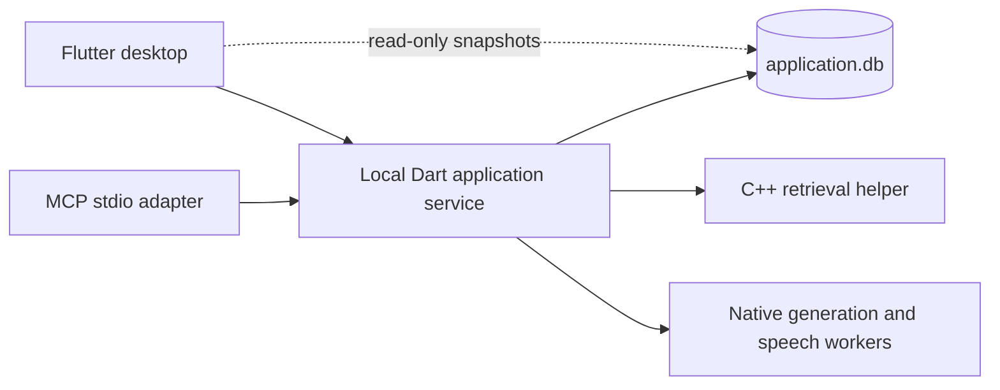

# Application service and MCP

Open Foresight uses one application service per profile. The Flutter desktop and MCP adapter share that service, its database writer, local models, retrieval helper, and recording session. The desktop opens a read-only SQLite WAL connection for rendering queries. All mutations go through named application operations on a private Unix socket.



The Flutter-independent package is `packages/foresight_core`. Desktop features use its curated `desktop.dart` API; only application startup imports `desktop_bootstrap.dart`. The former desktop exports of write-capable core implementations have been removed. Read-only typed projections, immutable status and explicit connection lifecycle replace direct Store/helper access; see [the desktop core boundary](desktop-core-boundary.md). Application operations, imports, source recovery, Google sync, model configuration, capture persistence, inactivity shutdown, the idle exit, and note enhancement live in the core. The desktop retains dialogs, browser interaction entrypoints, shortcuts, presentation, and graph layout/rendering; graph publications are validated and committed by the service.

## Desktop and core boundaries

The desktop accepts `DesktopConnection`; production connects `RemoteDomain` to the service. Generation, recording, Google account, and connected-source proxies implement narrow capability interfaces instead of inheriting worker implementations. Widget fixtures provide an explicit test adapter for that same connection contract.

`_WorkspaceState` coordinates navigation, lifecycle, and the shared update boundary. Sources and graph, chat, meetings, settings and models, and integrations each have a controller that owns their mutable state and screen widgets. SQL lives behind named core `Store` queries. Saved output statistics cache their text scan by database revision and are labelled as words because historical records do not contain tokenizer usage.

Application composition supplies explicit workspace ports to source, meeting,
Google, answer, indexing, note and status workflows. These ports retain the
existing store, cancellation, queue and generation owners while limiting each
consumer's available methods. `application_ports_test.dart` guards the migrated
constructor dependencies. Summary, recording and model-registry ports belong to
the separate native lifetime conversion and are not qualified by that test yet.
The pure balanced-transcript excerpt helper lives in `text_budget.dart`; it does
not require a service owner import.

`labels.auto_assign` acquires any missing embeddings, validates the source snapshot, then plans propagation and publishes all associations, the label cluster, and graph invalidation in one write transaction. A failed label write rolls back the entire publication. `Application` composes explicit business-service owners and the application operation registry. `AnswerCoordinator` admits answers, and each `ConversationAnswer` passes immutable retrieval, prompt and generation results between phases. Conversation queries own the atomic answer, memory checkpoint and meeting-link transaction. `Domain` owns lower-level source and model services and receives a `ModelGate`; it never constructs or looks up an `Application`. Callers, including fixtures, bind their application explicitly.

## Ownership inside the service

Every request checks its declared owner capability before dispatch, including
bootstrap operations and installer idle shutdown. The bundled service CLI sends
the current private profile capability for `--stop-if-idle`; shutdown refuses
while any desktop connection pins the service. Desktop attachment additionally
requires the verified executable, and approval-host actions require their live
host connection.

External clients need visible desktop consent before replacing saved notes,
meeting notes, tasks or artifacts. Consent is bound to the pre-dispatch content
snapshot. Schema 18 retains prior content atomically in `content_revisions`;
`Store.contentHistory` reads those snapshots for recovery through the existing
writers. Individual deletion and workspace clear erase the corresponding history.

Credential cleanup persists only profile-scoped key identifiers and revocation
flags in a private journal. One failed keyring deletion does not stop the other
accounts. Startup, periodic maintenance and disconnect retry remaining deletions
without restoring the cleared account registry. Remote revocation remains best
effort when the network is unavailable.

The relay process remains a forwarding owner; its worker owns the single profile
writer, application, helper and native runtimes. `ApplicationService` retains
request cancellation, dispatched activity, the idle timer and the one ordered
close path. Socket framing/writes, frontend forwarding, startup handoff,
connection state, admission and diagnostic storage have separate modules without
introducing another timer, lease ledger or profile lock owner. The existing
[lifecycle matrix](../testing.md) remains the acceptance contract.

Application composition passes explicit dependencies to WorkspaceAdmin,
ModelRegistry, SourceOperations, GoogleMaintenance, SummaryCoordinator,
MeetingWorkflowCoordinator, NoteEnhancementCoordinator and RecordingController.
MeetingIndexer coalesces identical work while Domain retains the source queue.
The plain transcript-window Questions path preserves its own artifact format;
it shares generation admission without gaining Summary checkpoints or manifests.
Feature families dispatch typed requests and invoke named persistence operations;
SQL remains in query, writer and migration modules.

GenerationCoordinator owns the single configuration/generation reservation.
Cancelling, clearing presentation state or acknowledging a native cancellation
never releases that reservation; the producer settles it after stream cleanup
and acceptance. Application shutdown stops scheduling synchronously and joins
actual producer completion before the service closes its writer/helper. Automatic
answers keep retrieval preemptible for foreground work: their queue may finish
cancellation before a retrieval finishes, but AutomaticAnswerCoordinator retains
its actual producer accounting and joins it during shutdown. Foreground answers
reserve before their first nonterminal retrieval await; an empty-context terminal
answer does not reserve a native resource.

The desktop connection owns its read worker and read-only connection. A worker
checks supported schema inside each read transaction; the authority checks again
before publication. Synchronous compatibility reads use the same short guarded
snapshots. Desktop readers never migrate a profile or own the service writer.
If a service read encounters a future schema, it retires heartbeat and change
snapshots for that owner's lifetime and returns actionable unavailable errors.
Its existing lifetime decisions retain the last verified idle policy.

## Build

Use the root build requirements and commands. Dart must be on PATH (the Flutter SDK supplies it). `tools/build.sh` builds the native components, checks/tests the core, compiles the service and MCP executables, and checks/tests/builds Flutter. `tools/package.py` includes all three entrypoints and their runtime libraries:

- `dist/open-foresight/open-foresight`: desktop.
- `dist/open-foresight/open-foresight-mcp`: MCP stdio server.
- `dist/open-foresight/open-foresight-service`: foreground service and administration commands.

For just the Dart executables after native compilation:

```sh
cd packages/foresight_core
dart pub get --enforce-lockfile
dart analyze
dart test
cd ../..
mkdir -p build/application
dart compile exe packages/foresight_core/bin/service.dart -o build/application/foresight-service
dart compile exe packages/foresight_core/bin/mcp.dart -o build/application/foresight-mcp
```

A packaged service or MCP adapter requires no Flutter SDK or Dart SDK. Reads work without an open desktop window; protected operations need the visible desktop approval flow. The existing native runtime and model prerequisites still apply. No model downloads occur merely because an MCP client connects.

## Configure an MCP client

Use the packaged stdio launcher:

```json
{
  "mcpServers": {
    "open-foresight": {
      "command": "/absolute/path/to/dist/open-foresight/open-foresight-mcp"
    }
  }
}
```

The default profile is `$XDG_DATA_HOME/open-foresight`, normally `~/.local/share/open-foresight`. Its default runtime directory on Linux is `$XDG_RUNTIME_DIR/open-foresight/<first 12 characters of profile hash>`, or `<profile>/runtime/<first 12 characters of profile hash>` without `XDG_RUNTIME_DIR`, so profiles never share a socket by default. An empty or relative `XDG_RUNTIME_DIR` is ignored, `$XDG_RUNTIME_DIR/open-foresight` must be private like the runtime itself, and a runtime whose `application.sock` path would not fit a Unix socket address is refused. Desktop and MCP must resolve the same profile and runtime directory. To choose an isolated profile, set both `FORESIGHT_DATA` and `FORESIGHT_RUNTIME` in the launcher environment:

```json
{
  "mcpServers": {
    "open-foresight": {
      "command": "/absolute/path/to/dist/open-foresight/open-foresight-mcp",
      "env": {
        "FORESIGHT_DATA": "/absolute/private/profile",
        "FORESIGHT_RUNTIME": "/absolute/private/runtime"
      }
    }
  }
}
```

Status reports the profile's identity: the first 24 hexadecimal digits of the SHA-256 of the canonical profile path. Clients, `--status`, `--stop` and `--stop-if-idle` refuse at once a service that reports another profile's identity. A service released before profile identity reports none, and every released service holds its profile's ownership lock. Such a service is accepted only while this profile's endpoint record still leads to it; a new owner takes the record out of sight as soon as it holds the lock, before it decides whether to adopt it. On Linux the service must also be the process that holds this profile's lock, as `/proc/locks` lists it; if that cannot be read, or the client runs in another pid namespace, such as a flatpak sandbox, the service is refused. macOS has no such list, so there any holder of the lock counts. The residual: on macOS, with an explicit `FORESIGHT_RUNTIME` that two profiles share, an older release of the other profile's service could be accepted in the moment between this profile's new owner taking the lock and taking the record out of sight. Default macOS runtimes are per profile, and the shared default runtime of earlier versions existed only on Linux. If a crashed owner's endpoint record names a runtime that another profile's service now uses, clients never attach there; they start this profile's service, which sets the record aside and serves from its own runtime. An owner never deletes or replaces a socket that still accepts connections. A regular file at a socket path is stale. A connect follows a link, so a link to a live socket is refused like the socket; any other link is stale and is removed as a link, never followed. On macOS a live socket whose listen backlog is full refuses a connection just as a dead one does, so an owner asks three times within 200 ms before removing it. A listener that drains its backlog meanwhile keeps its socket; one whose backlog never drains cannot be told from a dead socket, so it is replaced. That can only happen to another profile's service sharing an explicitly set runtime, because macOS runtimes are per profile by default. On a case-insensitive file system, such as the default APFS on macOS, an identity computed before the profile directory exists keeps the spelling given for the missing part of the path; once the directory exists, every spelling resolves to the case it was created with.

Both directories must be owned by the current user and inaccessible to other users. The launcher creates missing directories with mode 0700, and the service socket uses mode 0600. It opens no TCP listener. The adapter uses the pinned `mcp_dart` SDK for protocol negotiation, validation, stdio framing, progress, and cancellation. Stdout contains only MCP messages; diagnostics go to stderr.

## Agent approval and file access

Notes, source reads, local search, and local answers remain available to same-user clients. Agent requests to import, delete, clear the workspace, configure models/accounts, or send a question to web search require an **Allow once** decision in the visible desktop. The public service frontend verifies the accepted Unix peer's effective UID and executable: Linux uses `SO_PEERCRED` and `/proc/PID/exe`; macOS uses `LOCAL_PEERPID`, `LOCAL_PEERCRED` and `proc_pidpath`. Packaged peers must run the canonical installed desktop executable. Reading the capability file does not grant another same-user process approval rights. A successful verified attach rotates the capability and can replace the previous host; pending approvals belonging to that host are cancelled. Approval IDs remain bound to the requesting operation and expire after two minutes.

The worker accepts identity metadata only as the first frame on a bridge whose OS peer is the service process itself. It rejects external connections to `worker.sock`, including a desktop process that attempts to bypass frontend verification. Wire requests cannot supply or replace this metadata. This authenticates an installed executable under a trusted user-owned installation and operating system. It does not protect against arbitrary modification of installation files or same-user process injection; native signing and process-integrity policy are separate work.

For unbundled development only, the service launcher may set `FORESIGHT_DEVELOPMENT_DESKTOP_EXECUTABLES` to a JSON array of up to eight absolute native executable paths. For example, use the Flutter Linux debug runner at `apps/desktop/build/linux/x64/debug/bundle/open-foresight`, or the macOS debug app's `Contents/MacOS/Open Foresight`. Canonical OS peer paths must match that explicit list; scripts and generic Dart/Python interpreters do not qualify. Set it in the service's launch environment, never a request or database preference. Any configured installation root or packaged runtime revision disables this developer list. The compiled service/MCP development gate identifies its synthetic native approval relay and real Flutter test runner separately; it does not count as installed-package identity acceptance.

Direct desktop Start/Resume controls provide user consent without a second dialog. External recording start or resume requests require a visible desktop confirmation. The persistent recording controls show elapsed time, waveform, pause/resume and **Stop transcribing**. Lifecycle `resumed` and `inactive` count as visible, including a window that loses keyboard focus; `hidden`, `paused` and `detached` count as hidden. Hiding the desktop retains its host slot and reports visibility to the service. An existing, authorized recording continues while the window is hidden, minimized or covered; pending recording startup is cancelled, and new capture and approvals are refused until it is visible. Closing the desktop releases the host and finishes capture. Quick-meeting requests received through `commands.sock`, including a forwarded `--quick-meeting` launch, activate the window and ask for confirmation before creating or recording a meeting. Disconnecting just the MCP client leaves capture running while the desktop indicator remains visible.

In packaged installations, model runtime executables and query worker code must resolve inside the canonical installation root. Symbolic links do not permit escape. The check runs before admission and at execution boundaries, so an old saved external runtime cannot execute on restore; it reports an actionable denied error and can be replaced with a bundled runtime through model settings. Model data may remain in the profile. Source/development configurations without an installed root retain their runtime selection behavior.

Import folders start empty. Selecting a local file or folder through the desktop adds its containing folder to the profile's import roots. Agents can then request imports within those roots, subject to approval. Canonical paths reject symlink escapes and always deny the application profile, including Google tokens and the desktop capability. Only regular files up to 10 MiB are accepted. Directory imports inspect at most 10,000 entries, import at most 1,000 supported files, and accept at most 100 MiB in total. Extraction output is bounded and external extractors have a 30-second deadline. These checks also apply when refreshing previously imported files.

Peer verification protects the desktop approval connection against bearer-token theft. It does not sandbox code that can replace the trusted installation or inject into its process; private OS profile permissions and installation integrity remain required.

## Tools

| Tools | Behavior |
| --- | --- |
| `audio_capabilities` | Inspect audio backend, permissions, and system settings guidance without capturing. |
| `audio_request_microphone`, `audio_request_system` | Explicitly request microphone or system audio consent in an interactive session. |
| `get_status` | Model/helper readiness, index state, service PID, active capture, profile revision, Google connection status, and the service lifetime (`lifetime`). |
| `list_sources`, `get_source`, `search` | Source metadata/full text and relevant passages with IDs, titles, revisions, and scores. Search limit is 1–100. |
| `import_text`, `import_file`, `import_url`, `import_directory`, `refresh_sources` | Import/update sources and index them using the application's workflows. Supported local files: UTF-8 text/Markdown, PDF, RTF. |
| `delete_source` | Tombstone the source, remove indexed evidence, and preserve retry/recovery behavior. |
| `list_notes`, `save_note` | Read/create/edit personal notes. |
| `list_meetings`, `create_meeting`, `get_meeting` | Meeting metadata, original notes, transcript segments, generated artifacts, and edits. |
| `save_meeting_notes`, `import_transcript` | Save original notes or append final transcript evidence; index transcripts. |
| `generate_meeting_artifact`, `enhance_meeting_notes`, `edit_artifact` | Generate summaries/actions, enrich notes using evidence, or retain edits separately from generated originals. |
| `get_meeting_tasks`, `edit_meeting_task` | Read evidence-backed tasks with edit, completion and stale status; edit a task or its status while preserving extraction evidence. |
| `prepare_meeting`, `cancel_meeting_generation` | Generate a preparation brief from explicitly selected already-imported sources, or cancel active task extraction/preparation for a meeting. |
| `start_recording`, `pause_recording`, `resume_recording`, `stop_recording` | Use the shared microphone/playback capture and transcription lifecycle. Pause releases capture devices and retains queued pre-pause speech; Resume reacquires the same routes. |
| `ask` | Generate a grounded answer with checked citations using the configured local generator. |

Tool failures return `isError: true` with a useful message and a structured `error` containing a stable `code` and `message`. Codes distinguish invalid arguments, missing resources, busy workers, cancellation, unavailable services, denied access, and internal failures. An `unavailable` error may also carry a `reason`: `closing` (the service refused the request before running it, so retrying is safe), `outcomeUnknown` (the request was sent and may have committed), or `notSent` (it never reached the service). A `denied` error may carry `reason: needsDesktop` when the operation needs the desktop's approval and no desktop is attached. Invalid protocol requests are handled by the SDK. Tools expose their input schemas and effect annotations. Clients may supply a progress token for started/ongoing/completed notifications. `ask` returns the final checked answer; provisional generation remains internal to the service/desktop stream.

The operation identities live in `packages/foresight_core/lib/src/operations.dart`. Required descriptors define argument shape, access, helper readiness, model admission, activity and MCP projection. The wire adapter decodes one immutable typed request before access checks, leases, activity stamps or dispatch. The `Operation` enum declares 103 operations. Each `OperationRegistry` is constructed for one descriptor scope and rejects duplicate handlers, handlers from another scope and any missing operation of its scope, so each registry is exhaustive and duplicate-free for its scope. The scopes and the per-scope handler split are defined by the operation descriptors, not by this document. Desktop command interfaces and remote facades accept operation identities and convert them to wire names at the transport. `rpcTools` exposes 32 MCP tools, each built from exactly one entry of `operationToolProjections`. The RPC contracts check the frozen MCP schema of every tool, reject raw operation names outside approved declarations, and invoke every MCP tool over stdio against a controlled service socket. Request fingerprints retain the original argument field presence and JSON number representations.

The owned helper API is `foresight.helper.v1.RagService`; all failures use non-OK gRPC statuses. Legacy success acknowledgement fields retain their wire tags, but carry no error channel. The immutable recovered descriptor preserves historical message presence and edition features. `tools/generate_bindings.py` versions its package and source name for production. To regenerate Dart bindings, activate `protoc_plugin 24.0.0` and run `python tools/check_dart_bindings.py --write`. CI regenerates all three schemas and rejects drift; descriptor snapshots also check the control and web-content RPC shapes, defaults, and reserved tags.

## Shared operation and lifecycle

Launching either client attaches to an existing service or starts one. A per-profile OS lock prevents two launchers from creating competing owners. Clients can disconnect independently. Closing or disconnecting the desktop stops capture. Hiding, minimizing or covering the window leaves an existing recording running. Closing the MCP adapter leaves the meeting running while the desktop remains connected; models are released only when the process exits.

| Who is connected | Process exits when |
|---|---|
| Desktop only (no agent request within the idle period) | 1 s after the desktop closes, or `--stop` |
| Desktop and agent | Desktop close stops recording and approvals at once; agent work continues; the process exits one idle period after the agent's last request, whether or not the agent is still connected |
| Agent only | One idle period after the last agent request; a host that returns within the period attaches warm, after it relaunches |
| Any | `--stop`, `--stop-if-idle`, SIGTERM, or a crash |

`serviceIdleMinutes` sets the idle period in minutes (default 30; 0 disables the idle exit), separately from the recording's `inactivity` preference.

There is one recording and one active generation per profile. A second recording or simultaneous generation returns a busy error. Model configuration is rejected while another configuration, generation, or recording is active. Clients receive change events; the desktop observes content written through MCP and reconnects after a service restart. MCP reconnects on its next request after a lost connection. An in-flight mutation that loses its connection fails visibly and is not replayed automatically.

A closing service answers every request it will not run with a closing refusal (`unavailable`, reason `closing`, and the unchanged text "Application service is shutting down; retry after it exits."), including requests on new connections while it drains. A request still waiting for approval or for the helper gets the same refusal; one already running gets `unavailable` with reason `outcomeUnknown` before its connection closes. A bare EOF means the service crashed. The desktop and MCP send a refused request once more to the next owner, after the startup handoff; they never resend one whose outcome is unknown. The owner removes its sockets before its endpoint record and releases its profile lock last, so a record always names a live, draining or crashed owner. A replacement that fails to start records why in a per-launch status file, and the launcher reports that cause at once. A replacement that loses the profile lock makes no second attempt; it records only that it lost, and its launcher attaches to the owner that holds the lock, or launches again if nobody does. If all three launches lose the lock, the launcher fails at once and says so. Each launch serves only while its launcher still waits for it: the launcher creates the launch's startup status file before launching and deletes it when it returns, and a service that takes the lock after that file is gone exits without serving. So no launch becomes an owner that nobody asked for.

Cancellation belongs to the connection and request that started an operation. Canceling one answer cannot cancel another client's generation. Canceled model setup cannot replace the previous registration. Bulk import cancellation stops further files; already committed content and accepted indexing work are retained. Stopping a recording seals captured audio; accepted transcription work continues under the service's durable job owner even if the requesting client disconnects. Source indexing/deletion are serialized, source revisions gate index publication and citations, and changed original notes invalidate in-flight enhancement output.

Content is shared: editing/deleting an existing source or note is visible to both clients. Supplying an existing ID to an edit operation replaces its current text; the service does not merge concurrent edits. An edit by ID of an item that does not exist fails with `notFound` instead of reporting a save that wrote nothing. Only a deleted source leaves a tombstone, so only it is reported as one that no longer exists; any other unknown source or note ID is reported as naming nothing, and `save_note` and `import_text` add that omitting the ID creates a new item. `import_text` with an ID edits only a live source and never revives a deleted one or creates one under a chosen ID. General desktop Ask uses its own answer conversation; meeting Chat uses a separate `meeting:<id>` conversation for each meeting. Each MCP connection gets a separate follow-up/history context, with saved answers still retained in the shared profile.

A workspace clear reuses integer IDs. `get_status` (service `status`) returns `workspace_epoch`, a random token that each clear renews and that survives restarts. Tools that take an `id`, and the keyed creates below, accept it as `workspace_epoch`; if the workspace was cleared since, the call fails with `notFound`, before any desktop approval, instead of acting on an item that now has the same ID or replaying a create into the new workspace. `changed` events carry the epoch too, and `workspaceEpoch` cannot be set as a preference. Approval IDs are random, so an ID from an owner that has gone never names a request of its replacement. The desktop sends the epoch its views were read in with every edit by ID, and edit dialogs send the one they opened in. When another client clears the workspace, the desktop closes the editors and drafts that hold old IDs before it adopts the new epoch, and says in one line, without their text, if it discarded unsaved edits. It also reads the profile's epoch after every new connection, because events sent before the connection was listened to are lost. A reply that arrives after a reset is dropped, and an edit dialog is not opened while a clear has committed but the views have not reset yet. A failed desktop clear keeps unsaved meeting notes.

`save_note`, `create_meeting`, `import_text` and `import_transcript` (service `notes.save`, `meetings.create`, `sources.import` and `meetings.transcript`) accept an `idempotency_key`. The change and its result commit in one transaction. A retry with the same key and arguments returns the first result without writing again; a key used for a different operation or with different arguments is rejected with `invalidArgument`. Arguments are compared as JSON, so `1` and `1.0` differ. If indexing failed after the first attempt committed, the retry reports that failure as the source's failed state. Keys hold digests of content, so they are kept for 24 hours, pruned at startup and on each keyed write, removed with the source they imported, and removed by a workspace clear. URL, file, directory and Google imports need no key, because they already reuse the source for the same URL, path or Drive file. The desktop's New note, New meeting, Start transcribing and Import transcript keep one key per action for up to five minutes: a retry after a reply that may have committed reuses it, and opening another note or meeting releases it. For Import transcript, choosing the same file again for the same meeting is the retry; any other choice is a new import. Once a reply was lost, only success or the service's answer about the key itself (the workspace was cleared, or the key belongs to other arguments) releases the key; a later transport failure, refusal or busy service keeps it. A retry with edited text first resends the original arguments under the key to learn the ID they created, then saves the edit by that ID, so it never creates a duplicate. When a reply is lost, the desktop says the request may have completed and reads its views again. MCP adds advice to the tool's error text: retry with the same key if the call had one, otherwise check before retrying and pass a key next time. Either way it says that a key applies the change at most once only in the same workspace, so the agent should also pass `workspace_epoch`. When the reply to a desktop clear is lost, the epoch reported after reconnecting shows whether the clear happened.

Internal answer commands and streams accept an optional `meeting_id`. The service validates that meeting, chooses its canonical conversation, and atomically saves each answer with its meeting association. The desktop does not infer ownership from the latest global answer row. This isolates follow-up questions and generated-answer history; retrieval still searches the shared indexed knowledge sources. Previously saved answer conversations are preserved.

URL imports accept globally routable HTTP/HTTPS text pages by default. Every redirect is checked, HTTPS downgrades are refused, and DNS results are pinned for the connection. In the desktop URL dialog, enable **Allow private network addresses** only for a page you intend to read from your local network. MCP `import_url` and `refresh_sources` (service `sources.import_url` and `sources.refresh`) accept `allow_private_network: true` for an explicit per-request opt-in; it is false by default and is not retained for later refreshes. Downloads are limited to 5 MB and 30 seconds; decoding and HTML parsing run in a disposable isolate with a three-second deadline. The response charset controls decoding, including GBK, Big5, and Shift_JIS.

Google credentials and refreshes belong to the service. The service streams a sign-in URL to the desktop, which opens the browser even when MCP started the service without a graphical environment. Browser sign-in and consent are started explicitly from the desktop; MCP does not expose credentials or authentication tools. Google reminders and refresh timers run in the service while it is running, which with no desktop attached is until the idle exit.

Inspect or stop the service explicitly:

```sh
dist/open-foresight/open-foresight-service --status
dist/open-foresight/open-foresight-service --stop
```

`--stop` gracefully finalizes active recording, and returns only once the
service has released its profile (its lock is free or its process is gone),
failing if that takes more than 30 s after the service closed its
connections. The service finalizes any recording (--stop waits up to 30
minutes for that) and stops its helper before it closes them; it then closes
its store, removes its sockets and endpoint record, and releases its profile
lock. Scripts should therefore allow at least 60 s plus any recording
finalization. If the
service stopped without a clean shutdown, during `--stop` or before it,
`--stop` still succeeds and prints a warning; the next start recovers its
runtime. With no service and no endpoint record, `--stop` fails. A service
that is already stopping, because it refuses the status probe or its socket
is gone while it still holds its profile lock, gets "The application service
is already stopping." and the same release wait. A service released before
profile identity ends its connections before it finalizes a recording, so
`--stop` waits up to 30 minutes for it to release its profile. `--status`,
`--stop` and `--stop-if-idle` give up on a service that does not answer its
status within 30 s. For installers,
`--stop-if-idle[=PID]` uses the private `service.stop_if_idle` operation. It
atomically refuses active/finalizing recording and in-flight operations and
background model work, then blocks new calls before shutdown begins. It acknowledges success only after
resource cleanup; EOF, a failed close, or unverified helper ownership fails the
command. The optional PID and packaged installation/revision identity pin the
owner authenticated by the installer. Normal `--stop` behavior is unchanged.
Older services that lack idle-only shutdown must be stopped explicitly before
upgrading; installers never fall back to an unverified signal/EOF shutdown.

The next client attaches while the service is still running, otherwise starts one. An unexpected service crash marks unfinished recordings interrupted on restart and resumes pending source work. Stop an older, pre-service version of the desktop before upgrading a profile; that version does not participate in service ownership. Schema additions retain existing source, note, transcript, artifact, and model records.

## Verification

```sh
cd packages/foresight_core && dart analyze && dart test
cd ../../apps/desktop && flutter analyze && flutter test
cd ../..
.venv/bin/python -m pytest
ctest --test-dir build --output-on-failure
python3 -m pytest tests/service -v
```

`tests/service` runs actual service/helper/MCP subprocesses with controlled embedding, generation, speech, and capture fixtures. It checks shared writes/search, launch races, cancellation ownership, capture surviving disconnection, stale socket recovery, canceled model registration, desktop facade reconnection, browser invitation forwarding, and early OAuth cancellation. Set `FORESIGHT_DART_EXECUTABLE` if Dart is not on PATH.

The native UI gate requires a separately created private Agent Desktop session:

```sh
FORESIGHT_DESKTOP_SESSION=<owned-private-session> \
FORESIGHT_FLUTTER_EXECUTABLE=/absolute/path/to/flutter \
python3 -m pytest tests/service/test_service_process.py::test_native_desktop_and_mcp_share_service -v
```

This launches the actual Flutter app alongside MCP and checks visible meeting updates, shared capture, desktop teardown/restart, transcription, summary persistence, and the read-only desktop connection. Its evidence is written to `test-results/desktop-service-integration.json`. Controlled fixtures verify ownership and data flow; they do not measure real-model accuracy or physical microphone quality. `tools/test_meeting_workflow.py` launches `apps/desktop/integration_test/meeting_workflow_test.dart` on an owned Agent Desktop display. The virtual-audio acceptance gate runs that same test in its private PipeWire session and skips window capture there.

## macOS runtime and profile ownership

On macOS the default profile is `~/Library/Application Support/Open Foresight`.
Existing profile ancestors are canonicalized, so a symlink alias identifies the
same profile. `FORESIGHT_DATA` and `FORESIGHT_RUNTIME` remain explicit overrides.
The default runtime is a short private `$TMPDIR/of-<first 12 characters of profile hash>`
directory under the per-user macOS temporary directory. Long explicit paths are
rejected before attempting to bind a Unix socket.

The service takes a nonblocking POSIX advisory lock on
`<canonical profile>/.application.lock`, independent of runtime overrides. Its
private `.application-endpoint.json` records the active runtime directory. Clients
validate that directory and attach to the recorded endpoint. A service launched
with another runtime cannot acquire a competing profile writer. An unclean shutdown retains its runtime endpoint so a replacement service can adopt surviving helpers even when launched with a different runtime override. A clean shutdown closes workers and removes the endpoint record, allowing the next launch to relocate its runtime. Endpoint records are published only after acquiring the profile lock and binding a socket. Disconnected mutations with unknown commit state are still never replayed.

When its connection drops, the desktop reconnects at once. While its own launches keep failing, it waits 1 s, then twice as long after each failure, up to 30 s; a request waiting for the reconnect (at least 1 s after the last attempt), a service that starts serving, or closing the window ends a wait early, and a successful attach starts the count over. Attaching is bounded at 30 s. After a closing refusal, a client stops sending on that connection but keeps it open until the closing owner has answered the requests already sent on it (at most 5 s), so each gets the owner's own answer: a refused request is sent once more to the next owner, and a dispatched one reports that it may have completed.

Lock probes never run in a process that hosts an owner of the same profile
(L8). POSIX record locks belong to the process, not to a Dart isolate or a
file descriptor, so closing any descriptor of the lock file drops every lock
the process holds on it. `ensureService` (through `_profileOwnerAvailable`),
`--stop`'s release wait (`awaitProfileRelease`, through `profileReleased`), `profileLeftUnclean`, and on
macOS the identity check for a service that reports no profile identity
(`servesAnotherProfile`) each open, lock and close the profile lock to probe
it. In a process that hosts an owner, any of them would release that owner's
lock and let a second owner start. `_localServiceOwners` keeps `ensureService`
and the identity check from probing, but only in the isolates that started the
owner: another isolate of the same process sees no local owner and probes
anyway. The release wait and `profileLeftUnclean` have no such guard. No
shipped binary does this: a serving service process makes no client calls
(`--stop` and `--status` run as separate processes), and the desktop and MCP
host no owner. Keep it that way, or move the probe to a short-lived subprocess
or ownership to `flock(2)`, whose locks belong to the open file description.

Installed executables discover `Contents/Resources/runtime.json` in the nearest
enclosing `.app`. It maps `FORESIGHT_*` resource-path keys to paths relative to that
Resources directory. For bundled executables, this manifest owns resource and
code paths, the runtime revision, and the query terms URL; environment values or
a startup handoff cannot override them. Profile/runtime paths and allowlisted
scalar settings, such as backend/device choices and distribution API keys, remain
overridable. Development executables may use explicit resource and code paths.
Nested service bundles can refer to the outer app through relative `../` paths.
This map must contain the service, helper, native library, model runners,
audio-device adapter, and notification adapter as applicable. All resolved values propagate to detached
service launches and helper subprocesses. Packaged Mac services launch through
LaunchServices with a single `FORESIGHT_STARTUP_ENV` path in argv. Runtime and
profile overrides, including distribution keys, travel through a private 0600
file that the service reads and deletes before resolving its resources. macOS
default sockets live under its private per-user `TMPDIR`. This lets the service own its app
identity without a Flutter window. Plain development executables launch directly.
Service startup stderr is retained in the private runtime directory as
`service-startup.log`. The installed app must still verify the actual TCC
attribution. Profile content and downloaded models
remain outside the bundle. With no HOME environment variable on macOS, the system
user directory is obtained from Directory Services.

Audio enumeration runs through the service audio operation. Application composition
may inject an `AudioOperations` provider; the production default uses the host
adapter. Desktop environment process runners do not enumerate devices. Enumeration
returns device rows without requesting microphone or system access. The desktop
environment fixture exercises this operation with an injected service provider;
it does not qualify physical devices.

The Mac audio discovery adapter uses `FORESIGHT_AUDIO_DEVICES --list-devices` and
returns a JSON array of `{ "id": "stable-device-id", "label": "Device", "playback": false }`.
The Mac notification adapter uses `FORESIGHT_NOTIFICATIONS --title TITLE --message MESSAGE`;
errors are surfaced rather than treated as successful delivery. Discovery and
configuration do not request capture permission. Real TCC identity, recording,
model execution, and signed installed-bundle behavior require separate integration
gates; these interfaces alone do not prove those workflows.

`audio.capabilities` (MCP: `audio_capabilities`) inspects the service's audio
backend and permission state without prompting. `audio.request_microphone`
(MCP: `audio_request_microphone`) explicitly requests microphone authorization in
the service process; the blocking native request runs on another Dart isolate.
An improperly packaged service with no microphone purpose string receives an
actionable setup failure before entering the OS permission API.
`audio.request_system` (MCP: `audio_request_system`) explicitly exercises a short
system-audio tap consent request in the service, also off the event loop and
requiring the system-audio purpose string. Its JSON preserves `system_audio`
(`unknown`, `pending`, `denied`, `unavailable`), `system_audio_request`,
`permission_verified: false`, and native code/message/settings guidance. There is
no public CoreAudio permission preflight: a completed request or a successfully
started silent tap does not prove permission. Connecting, listing MCP tools, or
querying capabilities never invokes either permission request. User consent and
actual captured audio remain separate installed-app checks.

Configured generation and speech models retain runner provenance when an explicit
registration selects the current `FORESIGHT_LITERT_RUNNER` or
`FORESIGHT_WHISPER_RUNTIME` executable inside the canonical installation root.
The model row and its `modelRuntimeResource.<kind>` preference are committed
atomically. Metadata records the resource key, original runtime path, model
digest, and backend. After the app moves, model restoration, recording, readiness
checks, and setup UI resolve that resource from the current bundle without
rewriting the original row. A missing/non-executable resource or one pointing
outside the current installation is not substituted. External registrations,
legacy rows without provenance, and mismatched/corrupt metadata retain their
original runner paths. Re-register a legacy bundled runner explicitly through
model setup after backing up the profile; no automatic legacy migration guesses
ownership from a filename or an `.app` directory name.

Before native workers start, the shared runtime adapter copies its supported
settings into native process state using `fs_set_runtime_environment`. A Dart
configuration map alone cannot configure C/C++ `getenv` consumers. LiteRT and
Python bytecode caches default to `<profile>/cache/litert` and
`<profile>/cache/python` when an installed native runtime is configured.

Packaged runtimes also set `FORESIGHT_INSTALL_ROOT` to the canonical outer `.app`
and `FORESIGHT_RUNTIME_REVISION` to their build revision. Before loading native
code, opening the database, or starting workers, the service takes a shared,
nonblocking `flock` lease under the OS account's home (resolved independently of
`HOME`/XDG profile overrides):

- Linux: `~/.cache/open-foresight/install-locks/<installation hash>/lock`.
- macOS: `~/Library/Caches/io.openforesight.App/install-locks/<installation hash>/lock`.

The installation hash is the first 24 hexadecimal SHA-256 digits of the canonical
installed application path. New directories are private at creation and the
regular lock file is 0600, single-linked and opened without following symlinks.
The descriptor remains open for the service lifetime. On macOS, the installer
holds the exclusive new lock and a compatibility lock at the released
`/tmp/of-install-<uid>-<hash>/lock` path throughout staging and replacement.
Linux package hooks inspect both the released path and every NSS account's new
fixed cache path; they never use the root process's HOME/XDG values to discover
another user's service.

New Linux package hooks publish `.installation-maintenance` in the installation
root before checking locks. New services check it before and after lock
acquisition. Package completion removes it; interrupted installation keeps new
services refused until an explicit successful installation retry. A failed
preflight removes only the marker it just created. No package hook signals or
stops a live service.

The released Linux binary ignores the new maintenance marker: a legacy service
that starts after preflight can still race package replacement. Existing legacy
locks remain an upgrade refusal, but this does not close that concurrent-launch
lane. Qualification of that transition remains open; stop released clients before
upgrading and do not present lock probing as proof of old/new launch exclusion.
Older installer versions do not discover the new lock path, so close all clients
before any deliberate downgrade using an older installer.

Question-model metadata and downloads run in an internal transport-only service
subprocess. The parent owns cancellation, finite operation budgets and actual
reaping. Credentials and URLs travel through bounded stdin, never argv or
stderr; framed stdout carries only progress and transport results. This mode
resolves no profile or application ownership and loads no application native
library. It exists because the pinned Dart runtime can leave stalled TLS sockets
alive after `HttpClient`/isolate cancellation. A connect timeout retires the whole
transport process before retrying; successful partial-body resume stays within
that worker. Previous model registration changes only after authentication and
readiness succeed.

Status includes additive `application_api_version` (currently 1),
`installation_root`, `runtime_revision`, and `lifetime` fields. Clients carrying a
packaged revision validate the three identity fields before attaching, including an already-running
service from another app copy or revision. Canonical aliases of the same app
remain compatible. Mismatches require the user to explicitly stop the existing
service; clients neither stop it automatically nor replay mutations. Development
clients without a packaged revision keep the existing attachment behavior.

macOS PDF and RTF imports use the bundled `FORESIGHT_FILE_PARSER` executable,
backed by PDFKit and AppKit's attributed-string RTF reader. The CLI accepts
`--pdf PATH` or `--rtf PATH`, writes extracted UTF-8 text only to stdout, and
writes errors to stderr. It opens no Flutter window or permission dialog. A
locked PDF requires an explicitly unlocked copy; scanned PDFs without selectable
text report that OCR is needed. Empty or invalid documents fail before source
creation. File-access failures direct the user to Files and Folders permissions
or a readable copy. Linux retains its existing `pdftotext`/`unrtf` adapters and
existing stored provenance remains readable.

The actual Mac extractor can be checked with:

```sh
swiftc -O native/file_parser.swift -o /tmp/foresight-file-parser
python3 tests/integration/test_file_parser.py /tmp/foresight-file-parser
```

These developer tests generate real Unicode PDF/RTF, password-protected, empty,
malformed, and unreadable fixtures. The installed extractor itself requires no
SDK, Python interpreter, or external document-processing tools.

## Meeting and worker recovery

Recording retains conditioned audio in durable chunks independently of speech recognition. Pause releases capture routes after native finish and final publication drain; Resume starts another span in the same recording. Stop seals capture and returns without waiting for the transcription backlog to finish. Recognition uses durable jobs with frozen model/settings, bounded attempts and explicit retry after failure. Committed transcript segments and retained audio survive later processing errors. Startup reconciles interrupted capture and resumes eligible saved work; a transcription backlog never makes a stopped recording physically active.

The service owns playback, background compression and MP3/Opus export. Their reader references remain held until actual native worker exit, including cancellation. Missing codec support leaves captured audio and durable transcription work intact while playback/export capabilities remain unavailable. See [audio persistence](recording-audio-store.md), [presentation and capabilities](recording-audio-presentation.md), [worker protocol](audio-worker-protocol.md) and [protected export publication](audio-export-publication.md). Complete [database and audio backups](audio-backups.md) are separate from metadata-only migration snapshots.

Whisper retries a failed GPU invocation once with `-ng` on CPU, preserving the original audio and discarding the failed attempt's output. A LiteRT GPU failure rebuilds the generation worker on CPU for the next answer. The current answer fails visibly; tool calls are not replayed automatically. Native capture queue overflow emits an interruption with discarded-byte accounting, which is stored alongside the meeting transcript.

Linux installers with PipeWire outside `/usr/bin` configure the native library
with `-DFORESIGHT_PW_RECORD_EXECUTABLE=/absolute/installation/path/pw-record`.
This trusted build-time path defaults to `/usr/bin/pw-record`; native capture never
searches the process `PATH`. An explicit absolute executable supplied through
`FORESIGHT_CAPTURE_RUNTIME` still takes precedence for controlled deployments.

`application.resume` explicitly resets an exhausted helper restart budget and starts the helper again. It preserves a healthy helper. An incompatible helper transport requires an application-service restart instead of retrying a terminated connection. Shortcut IPC acknowledges that a command was queued; failures appear in the desktop workspace and shortcut status.

New `models.generation` registrations default to `litert_lm` when `backend` is omitted. Explicit `llama_cpp` registrations and previously stored registrations retain their selected backend.


Automatic question-model downloads require a genuine publisher terms URL in the
`FORESIGHT_QUERY_TERMS_URL` distribution setting (the same repository Actions
variable populates macOS packages). Acknowledgment is scoped to the authenticated
model digest and enforced by the service before acquisition. Distributions that
have not supplied terms cannot download this opaque model automatically.

Local source links reveal their file in Finder or the Linux file manager instead
of invoking a default application. Opening allowlisted files under revocable
import grants remains deferred with the typed import-grant architecture. Approval
dialogs show available requester information, highlight risky options and limit
repeated identical requests. Direct desktop Start/Resume gestures provide capture
consent; external requests require confirmation from the visible approval host.
Closing, detaching or disconnecting that host stops capture. Visibility changes alone do not stop an existing recording; a hidden host still cannot approve requests or start/resume capture. Verification of the
attached desktop executable does not establish the identity of every external
program behind an MCP connection.

### Model transport ownership

Question-model metadata and blob downloads run in a dedicated service transport
subprocess. Metadata calls cancel their live RPC at the deadline. Downloads bound
connect, response-header and body-idle phases to 30 seconds, each attempt to five
minutes and the complete retry operation to 15 minutes. Retry delays and parallel
ranges share the total budget. Timeout and cancellation terminate and reap the
owned process before releasing its operation; cancelling a Future alone cannot
reliably close a stalled TLS connection on the pinned Dart runtime.

The production service accepts the internal `--model-transport-worker` mode
before ordinary profile/service startup. Transport boundary tests compile the
actual service before starting their operation budgets and separately retain a
source/JIT total-deadline case. Question-model downloads retain their existing
buffered-byte semantics. Public
Gemma and speech assets reuse that worker ownership and deadline policy while
retaining their disk-backed resumable parts, bounded-memory assembly and final
checksum verification. Public-file whole-attempt budgets derive from independently
pinned catalog byte counts: five minutes of headroom, transfer at 256 KiB/s, and
five full disk passes at 1 MiB/s. The total allows the configured finite retry
count plus one minute for retry delays. Caller-asserted sizes do not set these
bounds. Connect/header/body-idle limits remain 30 seconds; question-model budgets
remain five/15 minutes. Only the final path returns to the service parent.

`models.inspect_asset` verifies a pinned model's existing cache/registration and
returns its path or null. `models.download_asset` requires a pinned kind/digest
and request ID, verifies publisher consent before network work, and performs
Gemma runtime preflight in the service. Progress is published in the normal
`model_asset_download` status value and each normal changed broadcast. The
validated optional `progress_key` (1–256 characters) correlates that presentation
with the desktop subscription independently of the service's authoritative
request ID and cancellation envelope. A desktop owns its subscription/current
predicate; the service retains its busy owner until download and worker cleanup
settle. Shutdown revokes new work synchronously and joins that producer before
model/runtime teardown. Existing model install operations keep their separate
configuration reservation and native ownership. If bounded preflight or transfer
termination cannot confirm child exit, the job's bookkeeping still settles and
a `restart_required` state blocks replacement downloads until service restart;
it does not claim the unknown child was reaped.

Transport cancellation closes the parent's owned stdout and stderr stream
readers while joining the worker's bounded termination attempt. A descendant
holding a pipe open cannot keep a cancelled operation waiting for EOF. Confirmed
cleanup also joins the parser. If cancellation cannot confirm worker exit or reader
retirement, the operation settles as `restart_required` rather than waiting for
the download's size-scaled deadline. Without cancellation, the existing attempt
deadline still bounds an absent exit acknowledgement.

Public workers return closed failure codes (`diskSpace`, `interrupted`, `hash`,
`https`, `invalid`) and an optional bounded required-byte count. The service maps
those to safe model-setup RpcErrors; model dialogs allow only known model error
messages and never display arbitrary exception, path or authenticated URL text.
Service cache hashing checks cancellation between streamed file chunks.
Audio discovery shares one in-flight adapter child and kills and reaps it on
timeout before admitting another enumeration.

Desktop setup imports model/catalog values, read-only cache helpers and the
remote downloader interface. Its compile closure excludes the HTTP download
engine and model transport worker. Tests inject explicit local download doubles;
production composition supplies the service proxy.


### Typed client calls

The existing operation descriptor constants own both request encoders and result
decoders. Each descriptor infers its concrete input and result types; its `send`
and `sendCurrent` extensions resolve the original `Operation` by descriptor
identity. There is no second wire-method registry. For example:

```dart
final created = await meetingsCreateDescriptor.send(
  connection,
  const MeetingsCreateInput(title: 'Planning'),
);
// created.id is an int; a source-deletion input cannot compile for this call.
```

`WireField.absent()` differs from `WireField(null)`. Encoders retain original
field presence, false/zero/null values, envelope spellings and date strings;
schema validation does not insert defaults before request fingerprinting. The
existing transport still owns workspace scoping, reconnect/resend policy,
current predicates and operation lifetime. Raw transport methods remain for v1
compatibility; production desktop/proxy callers use typed descriptors.

`sendKeyed` delegates to the existing `PendingRequestKey`. Its send-only captured
workspace envelope stays outside the original argument-comparison ledger. A
malformed data-bearing reply becomes `internal/outcomeUnknown` before that ledger
can release the key; retry therefore reuses the same key, and edited retries
learn the first result before amendment. Transport errors retain their identity,
code and reason. This layer adds no automatic retry or application ownership.

Data-bearing replies expose concrete immutable values. Partial Drive metadata
and optional capability fields retain presence. V1 void acknowledgement metadata
is deliberately discarded, and refresh status remains optional when the caller
only requires acknowledgement. This preserves old clear-after-disconnect and
ignored-result behavior without returning unchecked maps to consumers. Actual
application capture replies and cancellation booleans are decoded by their
corresponding contracts, rather than treated as void acknowledgements.


Model download progress uses an explicit optional `progress_key`, separate from
RPC-authoritative request IDs and cancellation. The typed desktop bridge sends
its local correlation key there. The acquisition owner publishes it through both
startup status and normal changed snapshots; capture-level telemetry leaves that
progress untouched. The real service-to-proxy fixture verifies checking phase,
correlation and terminal state without downloading a model or claiming installed
runtime acceptance.

Answer streams decode each chunk through `answerStreamDescriptor`, so malformed
chunks receive the same safe `internal/outcomeUnknown` classification as other
data replies. The client AST guard rejects direct command calls and method
tear-offs. Its exact RemoteDomain transport-leaf inventory permits the existing
desktop attach/visibility/detach, import-root consent, request/resend, clear-status,
Google sign-in and answer stream adapters, and separately records callback calls.
An extra operation, duplicate leaf or transport tear-off fails that inventory.
