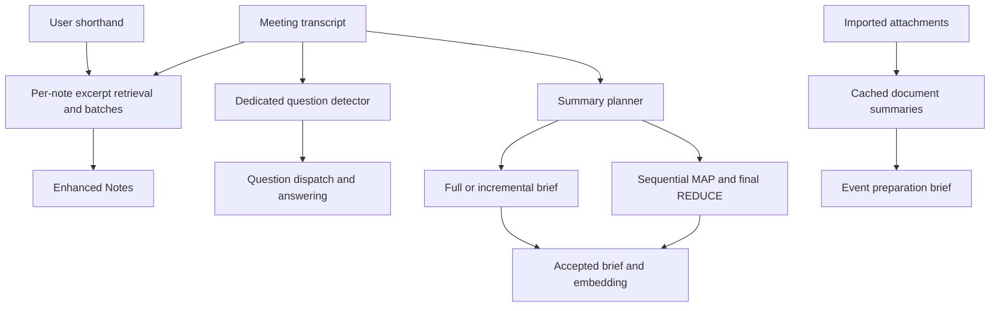

# Foresight AI workflows and recovered prompts

Foresight implements several distinct AI pipelines. Enhanced Notes retrieves transcript excerpts for individual shorthand notes; Live Q&A detects questions with a dedicated small model and then answers them; AI Summary chooses between full, incremental, and sequential map/reduce generation. Open Foresight already reconstructs much of the first two pipelines. At the investigated baseline `02d572fbd66022bb125d188dfa296ba7f2bf85bc`, Summary was the largest verified implementation gap. The dedicated implementation is now described in [Meeting Summary](../architecture/meeting-summary.md).

The [implementation plan](../plans/2026-10-20-foresight-ai-parity-plan.md) prioritizes completing these contracts while retaining the current service, native workers, storage, and desktop. Exact original prompt text, wrappers, regular expressions, stop markers, and decoded constants are in the [prompt catalog](foresight-ai/prompts.json). These are original recovered literals; current production prompts include additional Open Foresight instructions.

## Scope and evidence

Reference: installed Foresight **1.0.0.28.20261005**, bundle `com.google.AIEdgeForesight`, arm64 executable SHA-256:

```
fa98b856bfbe9b40cdebfb9f975f7867ec5c0a3ca75b81214a096a60b6db8326
```

Open Foresight source baseline: `02d572fbd66022bb125d188dfa296ba7f2bf85bc`. Investigation date: October 20, 2026, America/New_York.

The REA skill guided the investigation. Hopper could not start its bridge because macOS denied Apple Events. IDA Pro supplied the successful decompilation, using a private clone of a retained matching database. Its recorded input digest matches the installed executable and its patched-byte inventory is empty. A separate fresh REA/IDA import was interrupted after it failed to provide results; its failed logs are retained. The matching Dart snapshot was deserialized with the existing verified Dart library to read explicitly selected public pool entries. Only small readers were compiled; the SDK and models were not rebuilt. No original application Dart function or meeting-generation runtime was executed.

Evidence labels below distinguish:

- **Fresh static:** this investigation's executable, IDA, resource, or matching-snapshot observation.
- **Historical static:** earlier same-binary findings retained in Git history, corroborated where specified. Earlier test/runtime reports were not rerun.
- **Source:** current Open Foresight implementation, independently read in this checkout.
- **Proposed:** an Open Foresight design choice, rather than recovered original behavior.

Raw responses, complete paginated summaries, reader source, UTF-16 units, failed commands, and REA process-capture records are retained locally in `test-results/foresight-rea-20261020/`. The [evidence manifest](foresight-ai/evidence.json) records their identities and coverage. REA process captures establish execution of the analysis queries, not execution of Foresight's AI features. Decompiled pseudocode is not original Dart source.

## Feature comparison

| Feature | Foresight contract | Open Foresight baseline | Priority |
| --- | --- | --- | --- |
| Enhanced Notes | Per-note retrieval, greedy batches, separate conversations, streamed merge, native stop tokens | Substantial implementation already exists | Audit integration, cancellation, fallback provenance, and long meetings |
| Live Q&A | Dedicated raw-completion detector, rolling window, deduplication, dispatch, answering | Dedicated detector protocol plus durable queue and grounded answers | Portable detector deployment and real end-to-end evaluation |
| AI Summary | Full, incremental, tokenizer-aware map/reduce; preview, sanitation, checkpoints, embedding | Generic prompt over sampled transcript sections | Implemented here; see [Meeting Summary](../architecture/meeting-summary.md) |
| Calendar-page summary | A separate summary implementation includes Action Items | Separate generic Actions output exists | Preserve the distinction; establish runtime selection before claiming parity |
| Attachment brief | Document summaries followed by event-level synthesis | Imports/retrieval exist; equivalent meeting-preparation orchestration needs work | Recover and implement as a distinct feature |
| Chat and Ask | Context/date prompts, citations, structured history, memory compression, optional web tools | Extensive local grounding; deliberate web-policy differences | Version prompts and preserve explicit source/network scope |
| Source graph and capture | Embedding graph plus native audio-channel capture | Existing graph, labels, dual-channel recording, service/MCP | Validate boundaries rather than rebuild foundations |



## Enhanced Notes

The original producer is `NotesEnhancer.enhanceStream` at `0x100a2bd08`. The prompt builder at `0x100a32740`, chunker at `0x1009068f0`, and batch clustering at `0x100a328bc` were freshly inspected. The full producer, merge, lifecycle, and scheduler findings also survive in the historical notes at `58039c0^:docs/notes/`.

### Evidence selection and batching

Raw notes are split into meaningful lines with stable filtered indices. Existing accepted enhancements, already formatted notes, targeted edits, and optional updates determine which lines require model work. Transcript windows use **120 words with 20-word overlap in live mode**, or **300 with 40-word overlap in saved mode**, adjusting boundaries around sentence punctuation. Only the latest 50 chunks are retained. The recovered transcript embedding cache holds five meetings and reuses vectors by exact chunk text.

Each pending shorthand line is embedded. Cosine ranking selects two chunks per note when there are at most five pending notes, otherwise one. There is no minimum cosine threshold in this selector. If a note vector or any transcript vector is missing, the original falls back to the first one or two retained chunks. That fallback is a recovered compatibility rule, not evidence that its selected excerpts are relevant.

Greedy batches contain at most four notes. They favor overlapping excerpt references and satisfy:

```
350 * uniqueExcerptCount + 50 * proposedNoteCount + 300 <= 2000
```

The earliest seed is accepted even if oversized. Earlier rejected candidates are not revisited after a later candidate expands the overlap set. A singleton batch gets a second scan without the overlap requirement. Batches containing new notes run before existing-only batches.

### Exact prompt contract

| Pool entry | Purpose |
| --- | --- |
| PP34608 | Standard instructions: one ordered Markdown bullet per note; 1–2 concise sentences, about 20–35 words maximum |
| PP34602 | Concise instructions: one ordered bullet per note, about 4–10 words; never merge separate input items |
| PP34609 / PP34603 | Optional missed-topic instructions for Standard / Concise |
| PP34604–PP34607 | Relevant excerpts, shorthand notes, and output framing |
| PP34530–PP34546 | Excerpt IDs, item IDs, previous enhancement, and per-item reference framing |
| PP34554 | `</output>`, `<turn\|>`, `<eos>`, `<end_of_turn>` |

The prompt links each note's `<excerpt_refs>` to deduplicated `<excerpt id="E0">` blocks. It preserves the user's spelling, acronyms, product names, and technical terms over ASR spellings; keeps non-scribbles substantially unchanged; preserves prior facts; and requests only Markdown followed by `</output>`. Previous accepted output is supplied in `<previous_enhanced>`. Unmatched notes receive a cleaned original bullet.

At most two unused transcript chunks matching decision/action keywords can contribute missed topics, only in the final non-live batch. The optional section is `### 💡 Potential Important Topics Not In Notes`.

Each batch gets a fresh conversation. The literal `</output>` is tokenized and installed as a native stop sequence. The serialized **2048 input-token setting is not a 2048 output-token limit**; the prior complete native bridge investigation did not establish enforcement of this field. Keep admission policy separate from recovered configuration.

### Output and state

The producer emits complete merged previews in original note order. Preview cleanup and final acceptance have different code-fence behavior. The parser separately returns primary bullets and missed topics; it does not merge prose continuation lines. Missing model bullets and recoverable batch failures fall back to original notes. Raw shorthand is preserved independently of enhanced text.

Open Foresight already implements this across [the producer](../../packages/foresight_core/lib/src/reference_note_enhancer.dart), [prompt builder](../../packages/foresight_core/lib/src/reference_note_enhancement_prompt.dart), transcript cache, planners, ranking, parser, and merge helpers. Its prompt adds an untrusted-source preamble; that addition is absent from the recovered original. Remaining work is verification and reliability, especially stalled native cancellation, visible degraded results, stale edits, and evidence coverage beyond the latest 50 chunks.

## Live Q&A

The detector and answer generator are separate components. `QueryDetectorOnDevice.detectQuery` at `0x1009f2a18`, its generation closure at `0x1009f3620`, and initialization at `0x1009ee07c` were freshly inspected. Earlier buffer, deduplication, and dispatch traces are at `58039c0^:docs/recording/proactive-reference-trace.md` and `docs/models/reference-query-runtime.md`.

The dedicated detector receives raw completion input:

```
 <ctrl1>{prepared transcript}
```

The leading space is part of **PP24980**. It is not a general assistant prompt, a chat conversation, or a JSON extraction instruction. Historical same-binary analysis identifies a separate Gemma 4 200M text-cache model; that identification is distinct from the user-selectable larger Gemma model catalog.

The transcript manager builds a rolling context from finalized history since its cursor plus interim text. The original splits using `\s+`, removes the last five units for interim input, and retains at most the last **200 units**. Fresh assembly at `0x1009f2b9c` confirms the 200-unit subtraction. Open Foresight instead uses CJK-aware interim units and a **1000-Unicode-scalar** tail in `proactiveTranscriptWindow`; this is a deliberate port difference requiring its own evaluation. Empty detection does not advance the original history cursor in the traced path. Detection output undergoes UTF-8 repair and printable-ASCII/CR/LF filtering, splits at `?`, retains a final nonempty remainder, reverses candidates, removes duplicates, and excludes `>>` prefixes.

Two independent five-second hash deduplicators apply to transcript windows and dispatched questions. The original also uses a 20-second prefix/similarity filter; current reconstructed similarity tests cover expanding questions and suppression thresholds. Neither channel labels nor question extraction establish speaker diarization.

Open Foresight's [proactive pipeline](../../packages/foresight_core/lib/src/proactive_questions.dart) adds durable question jobs, restart recovery, retries, and transactionally linked answers. Capture does not await model work. Its answer stage retrieves from the workspace, including the indexed meeting transcript; it is not intrinsically transcript-only. Automatic acquisition of the dedicated detector is currently macOS/distribution-credential dependent. Protocol reconstruction alone does not establish a deployable Linux detector or multilingual quality; ASCII compatibility itself removes non-ASCII output.

## AI Summary

The active dashboard manager is `TranscriptSummaryManager.summarizeTranscript` at **0x100a45940**, with all 889 pseudocode lines retained across two pages. Its map/reduce wrapper is `0x100a47900`; the shared executor is `0x10095c6dc`, with all 998 lines retained. The pool values below are decoded with type-aware probes, including Dart booleans and tagged integers.

### Full and incremental generation

Input passes through structured-transcript/plain-text extraction and regex cleanup of leading channel prefixes. Empty supplied input may be loaded from saved event transcripts. Empty cleaned input produces no summary. With the refresh argument false, an existing cached summary is returned and first-time input under 100 words is rejected. A true refresh bypasses both gates; it does not necessarily force a full recomputation.

Let `L` be the current configured model context setting, default 4096, and `H = floor(0.5 * L)`. These dispatch thresholds compare **word counts**.

- Full input of at most `H` words uses the complete cleaned transcript with PP37753/PP37754 and system instructions PP37755.
- Incremental update requires refresh, an existing nonempty brief, a prior cleaned string length, transcript growth, and total words above `H`. A nonempty appended suffix of at most `H` words is combined with the previous brief using PP37749–PP37751 and system PP37752.
- Larger full input, or an empty/oversized incremental suffix, uses map/reduce over the full cleaned transcript.

Incremental eligibility checks character length, without comparing the earlier prefix in this method. Prefix edits can therefore invalidate the assumption that only an appended suffix changed. A content fingerprint is a proposed Open Foresight correction, not a recovered original rule.

### Exact summary prompts

**PP37755**, the full and final-reduction instructions, requests a strictly transcript-grounded executive brief containing:

```
# Overview
3–5 sentences, maximum 10, readable in 30 seconds

# Details
* **Header**: Body
```

The quoted layout above summarizes the instructions; the catalog retains the full exact original text. Headers are 3–5 words; each body has one or two sentences under 30 words. Include major decisions, future state, unfinished work, and disagreements; omit pleasantries and minor topics. Never attribute statements to Microphone, Remote, or device channel labels. Use real names only when clearly identified, otherwise describe the discussion abstractly. Use they/them, an objective tone, no preamble, and no square brackets.

**PP37752** updates an existing brief using the prior brief and new discussion, preserving key earlier talking points. **PP37772** extracts concise talking points and decisions from an individual chunk for the MAP stage. It includes the device-channel attribution restriction. MAP is at `0x100a4860c`; REDUCE is at `0x100a47e70`. Early local filenames invert these roles; function addresses and bodies establish their meaning.

### Long transcript processing

```
chunkWords = max(1500, floor(0.375 * L))
strideWords = max(1200, floor(0.8 * chunkWords))
maxChunkTokens = max(3000, floor(0.75 * L))
```

At `L=4096`, these are **1536 words, 1228-word stride, and 3072 tokens**. Stride is advancement, not overlap. When available, RemoteTokenizer measures chunks and truncates over-budget windows. Advancement adjusts to retained word count, bounded to keep moving and avoid skipping truncated-away words. Without usable truncation, the original candidate remains the fallback.

Chunks are processed **sequentially**, with cancellation checks before each MAP and before reduction. There is one final REDUCE call, not recursive hierarchical reduction. Zero partials yield empty text; one passes through unchanged; multiple partials are joined and synthesized with PP37755. The join uses `\n\n---\n\n` and a character cap `max(10000, 4 * (L - 1500))`, distributing prefix quotas and clipping the final string as needed. These word/character heuristics do not establish exact model-token admission for every prompt.

Summary requests use high priority, the `summary` tag, separate user/system fields, and a **120-second future timeout**. The original engine queues generation and creates/closes conversations. The configured `L` must not be relabeled as an output-token budget.

### Streaming and persistence

Per-event generation counters reject stale preview/progress callbacks. Cancellation increments the counter, removes active/preview entries, and interrupts the event's summary tag. These checks do not, by themselves, establish that every late final result is prevented from persisting.

Completion trims and applies an ordered attribution sanitizer at `0x10092fe0c`; the catalog includes its regex/replacement strings. It caches the summary and cleaned transcript's **UTF-16 length**, writes `transcript_summary_{eventId}` and `transcript_summary_len_{eventId}`, persists the event-transcript summary, and queues the summary for embedding. A generated summary therefore becomes input to later knowledge retrieval.

At the investigated baseline, the Open Foresight generation method sent `Produce $kind from this transcript only`, sampled bounded beginning/middle/end evidence, and set 1024 output tokens. It retained artifact history and revisions, but lacked the recovered Summary planner, incremental checkpoint, sequential map/reduce, summary-specific streaming, and ordered sanitation.

## Action Items and the second summary implementation

**PP24724** requests Overview, Action Items, and Details, with high-confidence named assignees or `None identified`. It also asks the model to acknowledge initial instructions with `OK`. Fresh IDA tracing binds it to the retained calendar-page `_generateTranscriptSummary` at `0x1009e7608`, through `InferencePipeline.processTranscriptStyle` at `0x1009764f0` and `SystemPromptedPipeline` initialization. This is a separate reachable implementation from the dashboard manager above.

The dashboard's active full/incremental/map prompts do **not** request an Action Items section. Static reachability does not establish which implementation a particular live UI action selects. Do not call PP24724 dead code, assume it is the dashboard prompt, or infer a standalone task-management backend from its heading. Exact calendar-page formatting transformations and selection are recorded in the evidence manifest as they are established.

The calendar page loads saved transcript and handwritten notes. Missing/invalid brief data or transcript/note timestamps newer than the saved brief trigger regeneration. It formats structured transcript under `--- TRANSCRIPT ---` and optionally appends `--- HAND-WRITTEN NOTES ---`. The prompt's grounding rule changes to include notes. Another attempted replacement searches for wording absent from this shipped default literal, so that first substitution has no effect on the default.

At most 2500 nonempty whitespace units take a single prompted pass; larger input uses the shared map/reduce executor and PP24743's synthesis instruction. `SystemPromptedPipeline` sends the instruction as a system-role message, awaits initialization, and clones the base conversation for each inference. Generated Markdown is stored inside the event transcript's JSON envelope as `notes_map.meetingBrief`, preserving other map entries, with UTC `briefLastModified`. `LIMIT_EXCEEDED` responses are not persisted as briefs. This is Markdown model output inside JSON storage, not a JSON-output task schema.

Open Foresight's separate `actions` operation is presently a generic transcript-generation artifact. A typed task schema with owner, due date, status, and supporting transcript spans would be a product addition. It should retain explicit unknowns and never infer an assignee from Microphone/Remote.

## Chat and other critical functions

The catalog preserves original Chat initialization **PP31008**, current-date/context/query framing, the attached-question-audio suffix, memory prompt **PP30834**, memory framing, and public Google search schema components. Historical bindings are at `58039c0^:docs/chat/`; fresh token-limit and pruning functions corroborate the memory route.

Chat instructions distinguish facts available in context, conversational responses, optional search, and insufficient evidence. `[Source:N]` labels connect answers to selected sources. The historical structured-history implementation stores plain user questions and assistant responses before display citation renumbering, rather than replaying the entire enriched current prompt as the historical user message.

History pruning uses `floor(0.55 * contextLimit)` as its trigger. It can compress the oldest half of message entries into a Context Memo, then remove oldest entries until the budget fits. This concerns entries, not necessarily complete question/answer pairs. Failed or empty compression falls back to removal.

Current Open Foresight intentionally requires explicit web use and treats external results/history as untrusted. Its local cited-answer JSON contract is also distinct from original Chat. Preserve these decisions and version their prompts separately from the recovered catalog. Google Search and external website-summary RPCs are network operations; the latter's remote Gemini model is not evidence that meeting summary generation is remote.

Attachment document summaries and event preparation form another distinct pipeline. Capture includes `_generateDocumentSummary` at `0x10095c2c0`, all 1809 lines of `_summarizeEvent` at `0x10095690c`, and `_synthesizeEventSummary` at `0x100959378`. Events are processed sequentially after ID-based deduplication. The coordinator resolves attachments to owned document/source text and caches document summaries separately from event briefs.

Document cache metadata includes content digest and summary under `AttachmentSummarization_{documentId}`, with migration of older records and sharing of in-flight work. Event reuse compares sorted document-content fingerprints. Empty input returns empty; trimmed input of at most **200 UTF-16 units** passes through without a model; over **50,000,000 units** produces a localized error. These are string-length limits, not file-byte limits.

Document MAP uses `Concise summarize the following document chunk:\n\n`; its REDUCE uses `Provide a cohesive summary of the following document chunk summaries:\n\n`. Caller settings are `max(3000, floor(0.75*L))`, `max(2500, floor(0.6*L))`, and `max(2300, floor(0.92*max(2500, floor(0.6*L))))`. At context 4096 they are 3072, 2500, and 2300. They are recovered caller arguments, not proof of native input/output enforcement. Safe joining uses `max(14000, 4*(L-600))` characters.

No successful document summaries yields empty synthesis; a singleton passes through; multiple summaries generate a local event brief using the event title and `Provide a cohesive summary of the meeting ... based on the following attachment summaries`. The coordinator appends document errors to the successful synthesized result. This is separate from the post-meeting transcript brief and the remote website-summary RPC.

The source graph uses embedding similarities and layout/label operations; it is not proof of an LLM-extracted entity knowledge graph. Existing Open Foresight graph and label modules should be retained. The native microphone/system channels are capture sources, not named-speaker diarization. Any new speaker or semantic graph feature needs its own evidence and evaluation.

## Model settings

The freshly reread [bundled model configuration](foresight-ai/model-config.json) lists Gemma 4 12B, E4B, and E2B. All three declare context 4096, temperature 0.4, topK 40, topP 0.9, repetition penalty 1.05, thinking disabled, speculative decoding enabled, and channel filtering in the KV cache. Declared memory gates are 30/15/6 GB and visual token budgets 560/280/280. Vision backend is GPU; audio is GPU for 12B and CPU for E4B/E2B.

These are shipped defaults and capability declarations, not proof of the exact runtime selection or effective settings in every feature. The dedicated question detector and embedding model are separate roles. Backend differences, tokenizer identity, and native stop support belong in generation provenance and compatibility tests.

## Coverage and remaining questions

| Question | Status | Boundary or next evidence |
| --- | --- | --- |
| Exact Enhanced Notes instructions and framing | Answered statically | Fresh literals and builder; full lifecycle also uses historical same-binary analysis |
| Enhanced Notes selected excerpt/batch behavior | Answered statically for described paths | Existing port and historical producer; real output quality unmeasured here |
| Detector prompt and parser | Answered statically | Dedicated model quality and cross-platform deployment remain separate |
| Dashboard Summary prompts and long-input strategy | Answered statically | Complete paginated manager/executor plus typed constants |
| Calendar-page Action Items template | Reachable static path established | Live UI selection and generated output not observed |
| Summary cancellation under final-token/persistence races | Partial | Counters/callback guards established; require process/runtime fixtures |
| Exact original natural-language output equivalence | Unresolved | Requires synthetic same-input runs against the original and port |
| Attachment preparation | Partial static coverage | Per-document and event pipeline captured; runtime/cache invalidation need acceptance |
| Hidden remote prompts, backend behavior, model weights | Unresolved outside recovered local contracts | Do not infer from client literals |

This pass validates recovered text, identities, and static control flow. It does not claim new native/core/desktop test passes or production feature parity. The implementation plan makes the remaining runtime and product gates explicit.
