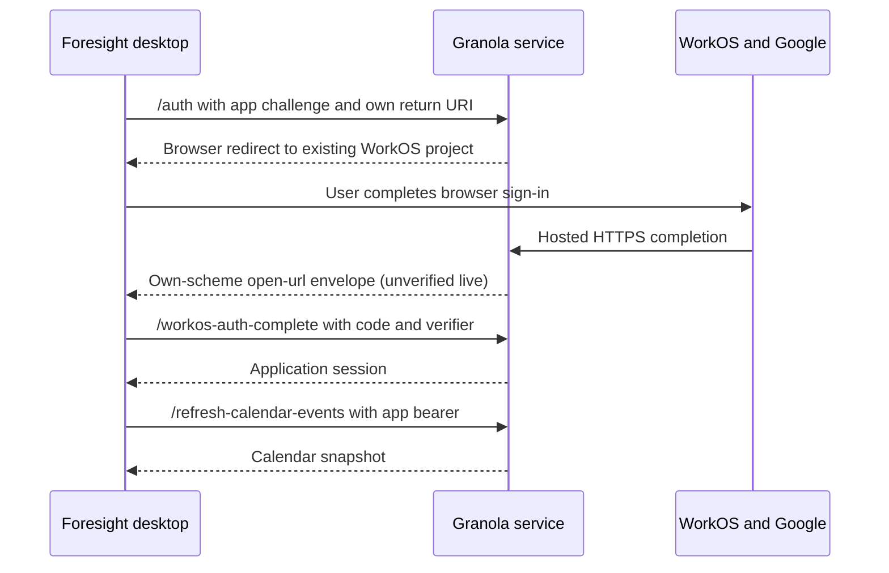

# Granola JavaScript authentication and calendar trace

Granola's Google Calendar connection is a hosted OAuth integration with a desktop handoff. The Electron client generates an app challenge, opens Granola's authentication service in the system browser, receives an opaque completion code through `granola://`, and exchanges it with Granola's backend for an application session. Calendar requests then use that application session against Granola's APIs.

This follow-up traces Granola 7.663.2 through its shipped JavaScript and fresh unauthenticated HTTP redirects on 19 October 2026. It resolves the hosted route and actual requested scopes that were unknown in the [initial investigation](granola-google-calendar.md). The tracing pass changed no application source, installed app, account permissions, or credentials. The subsequent opt-in implementation is described below.

## Observed browser route

A request constructed from the shipped desktop URL builder produced these redirects:

```text
api.granola.ai/v1/auth
  → api.workos.com/user_management/authorize
  → auth.granola.ai/user_management/authorize
  → accounts.google.com/o/oauth2/v2/auth
```

Google's requested callback is an HTTPS URL under:

```text
https://auth.granola.ai/sso/oauth/google/<connection>/callback
```

The WorkOS authorization request separately names this application return URL:

```text
https://api.granola.ai/v1/login-complete
```

All three hosted hops returned HTTP 302. Requests stopped before visiting Google's authorization page. Each variant used a new isolated cookie jar, fresh random challenge, and correlation ID, with no account identifier or existing session. The captured scope lists describe new authorization requests, not the historical grants on the user's account. [HTTP01, HTTP02]

| Hosted flow flags | Observed Google scope suffixes |
| --- | --- |
| Default initial sign-in | `userinfo.email`, `userinfo.profile`, `calendar.events`, `calendar.readonly` |
| `request_calendar_permissions=false` | `userinfo.email`, `userinfo.profile` |
| Calendar linking with `request_calendar_permissions=true`, `in_app_calendar_linking=true`, write flag omitted | `userinfo.email`, `userinfo.profile`, `calendar.events.readonly`, `calendar.readonly` |
| Same linking flags plus `calendar_write_linking=true` | `userinfo.email`, `userinfo.profile`, `calendar.events.readonly`, `calendar.readonly`, `calendar.events` |

Every scope above has prefix `https://www.googleapis.com/auth/`. The Google requests also carried `access_type=offline`, `prompt=consent`, and `include_granted_scopes=true`. No Drive scope appeared in these requests. [HTTP01, HTTP02]

This confirms that Granola's server chooses provider scopes from the selected flow. Its current default initial sign-in already requests event write access; the separate existing-account permission path still distinguishes read and write linking.

## Desktop and hosted handoff

| Step | Observed code path |
| --- | --- |
| Start | Google button handler `IOn` generates `signInClickId`, calls the imported Google auth URL builder, opens the URL, and navigates to `/login-in-progress`. |
| App challenge | `authUrls` generates a 43-character verifier and S256 challenge. It retains both in renderer memory and sends `code_challenge` to Granola's `/v1/auth`. |
| System browser | Renderer `window.open` reaches main-process `setWindowOpenHandler`; validated external URLs go to `shell.openExternal`. It does not open Google consent inside an Electron child window. |
| Hosted context | The live WorkOS authorization `state` contains the supplied app challenge as `codeChallenge`, plus platform/version, provider, correlation ID, and linking flags. The captured record retains only key names/types and challenge equality. |
| OS return | Packaged Granola registers the `granola` protocol. The main process handles an OS `open-url` event and parses `granola://login-complete?code=...`. The exact server-side construction of this successful redirect was not observed. |
| IPC | Main validates the completion data and emits `granola-url-received`; preload exposes its listener to the renderer. |
| Complete | Renderer combines the callback code with its in-memory `codeVerifier` and posts JSON to `/v1/workos-auth-complete`. |
| Session | The success handler consumes `{tokens,config}`, sends tokens to the main process, clears the verifier, and focuses the app. Calendar permission results are carried in configuration. |

Sources: JS01–JS10, JS19–JS21, and HTTP02.

The app challenge is not exposed as a Google `code_challenge` parameter in the observed Google authorization URL. It appears in the hosted WorkOS context, while Google receives a different opaque OAuth state. This establishes two distinct boundaries: provider authorization through the hosted service, and app-bound completion using the verifier. The backend's verifier validation and the type of the returned desktop code remain unobserved. It must not be described as a raw Google code solely from this trace.

The client handles verification-required responses using `pending_authentication_token` and an entered verification code. A normal login and an existing-account calendar-link completion are different mutations, rather than a single interchangeable callback handler. [JS07–JS09, JS13]

## Application session and calendar linking

The main process validates and retains session fields `access_token`, `refresh_token`, `expires_in`, and `token_type`, with optional session/sign-in metadata. It stores these under the application key `workos_tokens`. It refreshes them through Granola's `refresh-access-token` endpoint, and a request interceptor adds the application bearer token to configured Granola API requests. These are the session credentials used by the desktop; this does not establish that Google refresh tokens are delivered to it. No user's stored token values were read. [JS10–JS12]

For an already signed-in user, `g6t` uses a separate contract:

| Operation | Request | Consumed result |
| --- | --- | --- |
| `calendar-link-auth` | Application bearer plus `{clientVersion,isDev,platform,signInClickId}` | `{provider,redirectUrl}`; opens URL externally |
| Callback | `calendarLinkingFlow=true` with an opaque code | Queues completion data in renderer |
| `calendar-link-auth-complete` | Application bearer plus code, platform, correlation ID, optional current verifier | Success `linkedAccount.oauthProvider`, verification-required result, or error redirect |
| Confirm access | Calendar refresh every 2 seconds, for at most 120 seconds | Resolves missing-scope/token errors and completes linking |

This linking start request does not supply a new `codeChallenge`; its completion may include an existing in-memory verifier. Only initial sign-in is proven to generate the app challenge. Linking does not replace the primary application session. [JS13]

The Google write-access hook uses `/v1/auth` with `calendar_write_linking=true` and confirms success by polling `get-selected-calendars` until its `calendar_write` field becomes true. That is separate from the generic missing-calendar-permissions linking hook. [JS02, JS17]

## Calendar data contract

These requests execute through the renderer's shared fetch wrapper against Granola's backend. The normal desktop path does not send calendar fetches through a preload RPC or construct Google Calendar REST calls locally. Electron's main-process session interceptor can refresh and replace the application Authorization header. [JS09, JS12, JS14, JS15]

| Endpoint | Request body | Consumed response |
| --- | --- | --- |
| `refresh-calendar-events` | Empty; authenticated POST | `{results:{events,calendars,error}}` |
| `get-selected-calendars` | Empty; authenticated POST | `{calendars_selected,enabled_calendars,calendar_write}` |
| `set-selected-calendar` | `{id,selected,provider}` | Completion triggers another event refresh |
| `reset-selected-calendars` | Empty; authenticated POST | `{calendars_selected}` |

`calendars_selected` is an ID-to-boolean map, `enabled_calendars` contains provider names, and `calendar_write` is a capability flag. The calendar list UI uses `id`, `summary`, `backgroundColor`, `primary`, and `provider`. Events retain the Google-shaped metadata consumed by meeting features, including `calendarId`, start/end, attendees, recurrence, and conference details.

Refreshes occur after login, periodically, on window visibility, after preferences or selection changes, and after linking. The shipped default interval is 600,000 ms (10 minutes). A WebSocket refresh path exists behind a default-disabled feature flag. Concurrent refresh requests coalesce into one queued rerun. These are shipped behavior/defaults; runtime feature flags can override them. [JS13–JS16, JS22]

The client filters cancelled/declined events and requires timed starts, timed ends, and a summary. It sorts events, upserts them in `calendar_events(id,start_time,end_time,data)`, removes missing cloud events, and preserves `eventkit:` rows. Linked meeting-document metadata is updated while manually changed titles can be preserved. [JS14, JS18]

## Implemented Foresight connection

The research worktree includes an opt-in **Connect calendar through Granola** action in Settings. It uses Granola's existing hosted service and WorkOS project, without an application-owned project or Google Desktop client JSON. The existing direct Google connection remains available.

A fresh unauthenticated request accepted `redirect=open-foresight://login-in-progress?foresight_state=<random>` and an app challenge together. It returned HTTP 302 to WorkOS client `client_01JZJ0XBDAT8PHJWQY09Y0VD61`; the JSON state preserved the exact return URL and challenge. This corrects the earlier inference that a rejected localhost return meant every non-Granola return was blocked. **Initial acceptance does not establish that successful login returns to this URI.** See the sanitized HTTP03 observation (`.granola-analysis/live-foresight-return.json`).

The shipped web-shell bootstrap (`dist-app/assets/index-hW7uFomT.js`, function `S`, offset 64880) reads an `open-url` query parameter, decodes an inner URL, and dispatches the inner path as a deep-link event. Its `getPendingDeepLinkUrl` feeds the same renderer login-completion handler as Electron. This supplies the evidence for the implemented envelope receiver; the hosted server's successful construction of that envelope remains unobserved.



The Dart implementation generates a fresh 43-character verifier, sends its SHA-256 challenge to `/v1/auth`, binds the return envelope to random state, and exchanges the opaque completion code with Granola. It never reads installed Granola credentials or registers the `granola` scheme. macOS queues early `open-foresight` URL events; Linux forwards its own-scheme return to the running desktop through a private command socket. Stale, foreign, duplicate, wrong-state, SSO and calendar-link callbacks are rejected.

App sessions carry a provider marker in Foresight's private credential registry and use its platform secret store. Changing providers requires signing out of saved accounts. Refresh requests go to Granola; these credentials are never sent to Google's Drive, token, or revoke endpoints. Disconnect removes the saved Foresight session without revoking the upstream grant or logging out another Granola client.

Calendar sync consumes `{results:{events,calendars,error}}`, updates meeting metadata, and cancels missing cloud events only after a valid successful snapshot. Meeting IDs are preserved; the default interval is ten minutes. The backend supplies Granola's calendar selection; a separate selection UI is not implemented. **Drive is unavailable**: menus are disabled, background sync skips it, and core direct-Google requests reject Granola sessions.

The connection uses Granola's default initial sign-in, whose observed scopes include Calendar write access. The UI therefore does not call this a read-only grant. Verification-required responses leave no saved authorization, but verification-code entry/resubmission is not implemented. The connection remains experimental and depends on an external service protocol. The user confirmed successful sign-in through the HTTPS handoff; independent inspection of authenticated calendar contents was not performed. It depends on Granola continuing to accept this client protocol.

## Manual return-link fallback

During the user's live test, sign-in opened the installed Granola application. This means accepting the initial caller-supplied redirect was insufficient to establish the expected successful Foresight return. The user subsequently identified the return as Granola's HTTPS `/app-redirect` handoff. The callback code and signed context are not copied into research artifacts.

The Foresight sign-in dialog now accepts an explicitly pasted `granola://login-complete?...` return link. This manual path requires an active Foresight attempt and its original in-memory verifier. If the callback contains `signInClickId`, it must match the active attempt. Automatic delivery still requires the Foresight scheme and matching envelope state; the manual fallback does not register or take over Granola's scheme.

The raw link is obscured in the text field, excluded from error messages, and cleared after submission. It is not written to disk. Only a successfully exchanged application session is persisted through the existing credential registry. An expired, consumed, or different-attempt code cannot be made reusable by saving its URL. Restarting the service requires a fresh sign-in because the old verifier is deliberately not persisted.

Follow-up validation: 16 targeted core tests and 7 desktop tests passed, including explicit manual submission, wrong-attempt rejection, cancellation, duplicate submission, code redaction, and UI retry. Core/desktop analysis and rebuilt service/application compilation passed. The compiled subprocess suite passed 21 tests with its native-desktop case skipped; its new manual-return case checks the live service boundary without sending fixture codes to Granola. The updated standalone app was opened and its new field verified through accessibility state. At this stage the real exchange had not yet been verified; the later HTTPS correction and user confirmation are recorded below.

The standalone test app is `Open Foresight Calendar Test.app` in the ignored `.granola-analysis/` directory, using a separate manual-test profile. It reuses the completed native/helper artifacts and the newly compiled application service.

## HTTPS handoff correction

The actual user return used `https://www.granola.ai/app-redirect`, with the completion code, signed `authContext`, and flow/correlation fields in its query. The initial manual implementation accepted only the native callback address, so it rejected this wrapper before any exchange. That is the confirmed cause of the reported generic rejection.

The public page's JavaScript function `v` reads those fields and constructs `granola://login-complete?...`; the page then assigns that URL to `window.location.href`. Its URL without credentials was fetched for inspection. See WEB01 (`.granola-analysis/https-return-evidence.json`) for the public source URL, hash, exact excerpt, and evidence boundary.

Manual paste now accepts that exact HTTPS origin and `/app-redirect` route, forwards the query values to the same native-completion validator, preserves `authContext`, and exchanges the code with the active attempt's verifier. It never fetches a supplied callback URL. Other origins, userinfo, nonstandard ports, duplicate authentication parameters, mismatched attempts, missing codes and unsupported flows are rejected. A browser-added trailing slash and an encoded native callback are also supported. The UI shows only allowlisted, fixed validation reasons, so credentials and remote error bodies remain excluded.

The correction passed 19 targeted core tests, 7 desktop tests, 21 compiled-service tests (one native desktop case skipped), analysis, compilation, signing, and format/lint checks. The rebuilt standalone app was reopened, and a fresh waiting sign-in dialog visibly confirms support for both URL forms. The user subsequently reported “It works” after testing the fresh HTTPS handoff. This establishes user-reported sign-in success; calendar contents and saved credentials were not independently inspected. No SDK/native libraries were rebuilt.

## Implementation validation

All checks use Flutter 3.35.7 / Dart 3.9.2. Existing native libraries and helpers were reused; SDKs and dependencies were not rebuilt. The original worktree still has only the user's pre-existing untracked `docs/plans/`.

| Check | Result |
| --- | --- |
| Core suite | Final pre-PR run: 1,078 passed, 8 optional/environment skips; complete suite with current native/helper binaries |
| Core coverage | Final pre-PR run: 93.23%, above 90% |
| Native-dependent core supplement | 32 passed; exercises native-dependent cases skipped by the first run |
| Desktop suite | Final pre-PR run: 259 passed, 13 optional/platform skips |
| Desktop coverage | Final pre-PR run: 92.04%, above 90% |
| Compiled service/MCP subprocess suite | Final pre-PR run: 21 passed, one native desktop case run separately |
| Real macOS desktop/service/MCP integration | Passed with a synthetic isolated profile and controlled audio/inference fixtures |
| Existing native CTest inventory | 32 cases passed across original and corrected replay runs |
| Analysis and builds | Dart/Flutter analysis, Swift callback type-check, plist validation, service/MCP compilation and macOS Debug application build passed |

The first full core run exhausted temporary storage, and a settings fixture initially waited on real I/O from Flutter's fake async zone. Both were corrected and the affected suites rerun. Native replay corrected relocated source paths/library lookup and used matching cached binaries for the deadline case. Earlier failure logs are retained; these are not claimed as passing runs. Detailed results and reused binary checksums are in the ignored validation record (`.granola-analysis/validation.json`) and native reuse record (`.granola-analysis/native-reuse-validation.json`). Logs are under `/tmp/foresight-granola-*.log`.

Linux native desktop/DBus checks and model-weight-dependent optional acceptance were not run on this Mac. Local mocks and the macOS desktop integration do not verify live Google Calendar contents. The subsequent real sign-in succeeded according to the user; automatic own-scheme return and independent calendar-fetch observation remain unverified.

The artifact names below identify private historical research evidence, not downloadable repository files. Extracted proprietary code, application databases, and live authentication material are excluded from Git.

## Evidence and remaining boundaries

| Evidence | Local artifact |
| --- | --- |
| JS01–JS22 | Integrity-verified JavaScript excerpts (`.granola-analysis/javascript-auth-calendar-evidence.json`), with member hashes and Unicode offsets |
| HTTP01 | Identity-only, write-linking, and original default redirect observations (`.granola-analysis/live-auth-redirects.json`) |
| HTTP02 | Read-linking redirect and challenge/state observations (`.granola-analysis/live-calendar-read-redirects.json`) |
| HTTP03 | Foresight own-scheme return with preserved state and challenge (`.granola-analysis/live-foresight-return.json`) |
| Prior REA application graph | `ev_e348d36bd1a3ea1396615a174375f03f39b2c3139d4e0be1cb8d60678a713cfe` |
| Prior REA auth export trace | `ev_e90422beabd081e5c3df94497731d16a159fffb0f55fd6bfcaba8084ff0b7d65` |

All thirteen JavaScript members used in this pass match their original ASAR integrity declarations and the extracted copies. The ASAR SHA-256 remains `17046e95777b85a211b1e6676ac86bd5835c30b51928051411a796017a1302b9`. Existing REA evidence was reused; the full-ASAR analysis was not repeated. Optional Wakaru readable-source recovery is unavailable on this macOS host; exact bundle text and alias tracing supply the static findings instead.

The existing Electron runtime has no discovered CDP listener. Packaged code removes unauthorized debugging switches, so this pass did not restart, patch, or weaken the app to attach a debugger. Agent-captured HTTP observations are confined to unauthenticated hosted redirects; the later user-reported sign-in success is recorded separately above. Successful account consent, authenticated completion responses, user calendar API responses, and server-to-Google calls were not captured.

Authentication entry points, browser routing, requested scopes, callback handling, client session lifecycle, calendar contracts, refresh scheduling, and local persistence are answered within those boundaries. Server-side state/verifier validation, the desktop code's exact type, provider token custody/encryption, historical user grants, backend sync windows/webhooks, and the cause of Foresight's current failure remain unresolved.

## Pre-PR review

Review corrected cancellation-generation ordering so switching or signing out of an account can cancel an active Granola sign-in without invalidating its own credential update. A regression exercises both operations with saved accounts. Malformed JSON responses now produce a fixed error rather than exposing response text through a parser exception. No callback code, signed handoff context, session credential, proprietary bundle, or test profile is included in the commit.

The final pre-PR runs used the unchanged, matched 0.1.2 native/helper outputs from `b342da282a96`, current compiled Dart service/MCP executables, and the current macOS app. The full core suite ran with four concurrent tests and the repository coverage formatter/enforcer; desktop used the CI enabled-hook define and coverage command. The explicit source-compiler enabled-hook regression also passed. Service fixtures required a shorter private temporary path to stay within macOS Unix-socket limits. The real desktop fixture initially refused a leftover manually generated Debug runtime manifest; that manifest was preserved separately before retry. Failed outputs remain in `/tmp/foresight-granola-pr-*.log`.
